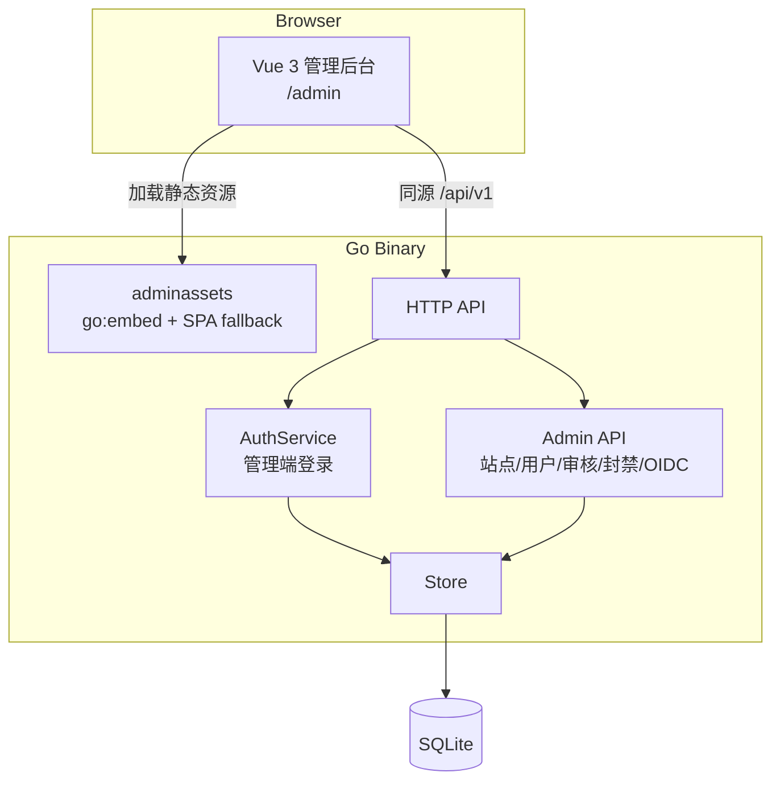
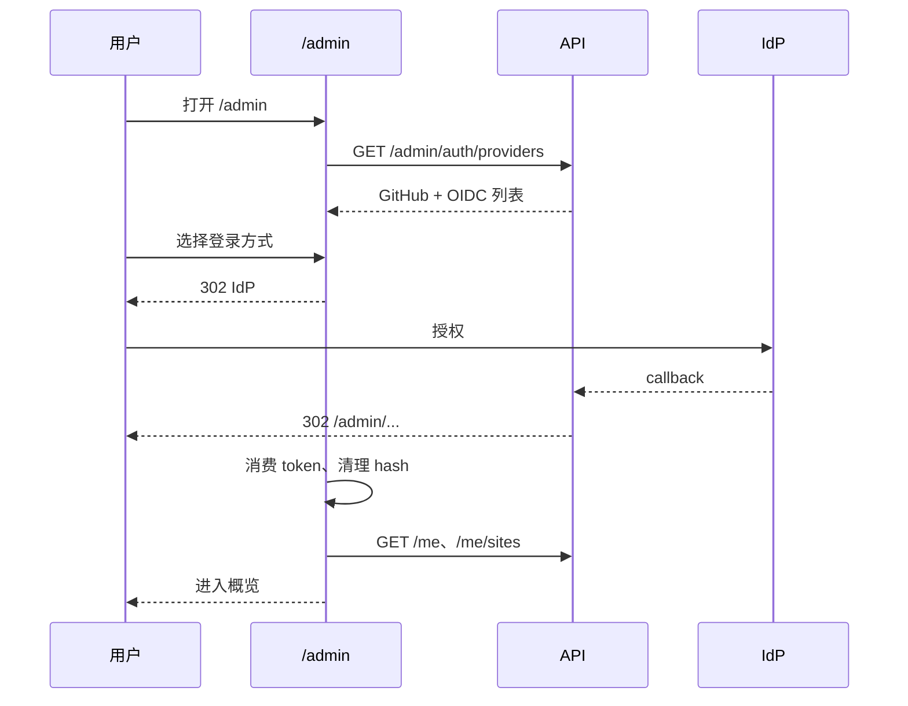
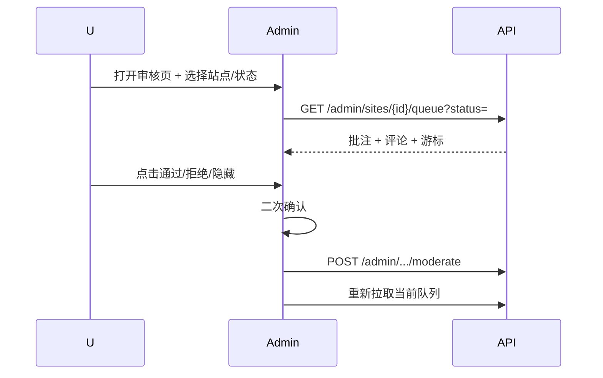

# Annotation Service 管理后台 Web UI · Plan

> 状态：草案 v0.1（等待评审）
> 输入：`.specs/admin-console/spec.md`
> 目标：交付内嵌 `/admin` 的 Vue 3 + Element Plus 治理后台，并补四项后端能力。

## 1. 架构概览



**部署形态**

- 后台构建产物输出 `admin/dist`，复制到 `internal/adminassets/dist`，由 Go `go:embed` 托管。
- `GET /admin` / `/admin/*`：优先匹配静态文件；未命中时返回 `index.html`（SPA fallback）。
- 与 API 同源，不需要 CORS/Cookie；认证仍使用 Bearer token。

**前端分层**

- `router`：路由与守卫（登录态、角色）。
- `api`：统一请求、错误映射、类型定义。
- `stores/auth`：token、当前用户、可管理站点、登录/退出。
- `views`：概览、站点、站点详情、用户、审核、登录。
- `components`：表格、对话框、状态标签、空态/错误态、站点选择器。
- `layout`：侧边栏 + 顶栏 + 内容区。

## 2. 核心数据结构

### 2.1 后端新增类型

```go
// 管理端登录方式
type AdminProviderView struct {
	ID       int64  `json:"id"`
	SiteID   int64  `json:"siteId"`
	SiteName string `json:"siteName"`
	Name     string `json:"name"`
	Issuer   string `json:"issuer"`
}

type AdminAuthProviders struct {
	GitHub    bool                `json:"github"`
	Providers []AdminProviderView `json:"providers"`
}

// 概览
type OverviewCounts struct {
	Sites              int `json:"sites"`
	Users              int `json:"users"`
	Annotations        int `json:"annotations"`
	PendingAnnotations int `json:"pendingAnnotations"`
	Comments           int `json:"comments"`
	PendingComments    int `json:"pendingComments"`
}

type Overview struct {
	Counts            OverviewCounts    `json:"counts"`
	Sites             []domain.Site     `json:"sites"`
	RecentAnnotations []domain.Annotation `json:"recentAnnotations"`
	RecentComments    []domain.Comment  `json:"recentComments"`
}

// 站点封禁视图
type SiteBanView struct {
	UserID    int64     `json:"userId"`
	Name      string    `json:"name"`
	AvatarURL string    `json:"avatarUrl"`
	Reason    string    `json:"reason"`
	BannedBy  int64     `json:"bannedBy"`
	CreatedAt time.Time `json:"createdAt"`
}
```

### 2.2 仓储新增方法

```go
type ProviderRepo interface {
	// 新增
	ProviderByIDAny(ctx context.Context, id int64) (domain.OIDCProvider, error)
	ListEnabledWithSite(ctx context.Context) ([]ProviderWithSite, error)
	// 现有
	// ...
}

type ProviderWithSite struct {
	Provider domain.OIDCProvider
	SiteID   int64
	SiteName string
}

type AdminRepo interface {
	// 新增
	ListAdminSiteIDs(ctx context.Context, userID int64) ([]int64, error)
	ListSitesForAdmin(ctx context.Context, userID int64) ([]domain.Site, error)
	ListSiteBans(ctx context.Context, siteID int64) ([]SiteBanView, error)
	// 现有
	// ...
}

type StatsRepo interface {
	CountSites(ctx context.Context) (int, error)
	CountUsers(ctx context.Context) (int, error)
	CountAnnotations(ctx context.Context, siteIDs []int64, moderation domain.ModerationStatus) (int, error)
	CountComments(ctx context.Context, siteIDs []int64, moderation domain.ModerationStatus) (int, error)
	CountDistinctAuthors(ctx context.Context, siteIDs []int64) (int, error)
	RecentPendingAnnotations(ctx context.Context, siteIDs []int64, limit int) ([]domain.Annotation, error)
	RecentPendingComments(ctx context.Context, siteIDs []int64, limit int) ([]domain.Comment, error)
}
```

### 2.3 前端核心类型

```ts
type Me = {
  id: number
  displayName: string
  avatarUrl: string
  isSuperadmin: boolean
}

type AccessibleSite = {
  id: number
  key: string
  name: string
  displayName: string
  status: 'active' | 'disabled'
  moderationMode: 'post' | 'pre'
  origins: string[]
}

type Provider = {
  id: number
  siteId: number
  name: string
  issuer: string
  clientId: string
  scopes: string[]
  allowedEmailDomains: string[]
  enabled: boolean
  updatedAt: string
}

type BanView = {
  userId: number
  name: string
  avatarUrl: string
  reason: string
  bannedBy: number
  createdAt: string
}
```

## 3. 后端设计

### 3.1 管理端登录

新增公开接口（同源，无 CORS 需求）：

```
GET /api/v1/admin/auth/providers
GET /api/v1/admin/auth/github/start?redirect=<admin 页面>
GET /api/v1/admin/auth/oidc/{providerID}/start?redirect=<admin 页面>
```

- `providers`：返回 `github: bool` 与所有启用 OIDC 提供商（含站点名、issuer）。
- 登录入口：
  - 生成一次性 `auth_flows`，`mode=login`；
  - GitHub：`providerType=github`、`siteID=0`；
  - OIDC：通过 `ProviderByIDAny` 查提供商，`siteID=provider.SiteID`；
  - `returnTo` 只允许 `${PUBLIC_BASE_URL}` 同源且路径以 `/admin` 开头，否则回落到 `/admin/`。
- 回调复用现有 `/api/v1/auth/github/callback` 与 `/api/v1/auth/oidc/{id}/callback`。
- 成功后仍以 `#annot_token=<token>` 回跳；后台启动时消费并清理。
- 超管仍由 `SUPERADMIN_GITHUB_LOGINS` 或 CLI 提升；站点管理员由超管在后台指定。

`AuthService` 新增：

```go
func (a *AuthService) StartAdminGitHub(ctx context.Context, returnTo string) (string, error)
func (a *AuthService) StartAdminOIDC(ctx context.Context, providerID int64, returnTo string) (string, error)
func (a *AuthService) AdminProviders(ctx context.Context) (AdminAuthProviders, error)
```

### 3.2 可管理站点

```
GET /api/v1/me/sites
```

- 超管：全部站点。
- 其他用户：`site_admins` 中分配的站点。
- 返回完整站点信息（含 siteKey），便于后台展示与复制。

`AdminService` 新增：

```go
func (a *AdminService) AccessibleSites(ctx context.Context, p domain.Principal) ([]domain.Site, error)
```

### 3.3 概览

```
GET /api/v1/admin/overview
```

- 计算可访问站点集合：
  - 超管：全部；
  - 站点管理员：`ListAdminSiteIDs`；
  - 普通用户：空集合 → 全 0 与空列表。
- 统计：
  - `sites`：可访问站点数；
  - `users`：超管为全局用户数；站点管理员为这些站点内出现过的去重作者数；
  - `annotations` / `pendingAnnotations`；
  - `comments` / `pendingComments`；
  - 最近待审批注与评论各 10 条。
- 站点管理员无站点时返回 200 + 空数据，不报错。
- 权限由 `Principal` 与站点集合决定，不信任前端传参。

### 3.4 站点封禁列表

```
GET /api/v1/admin/sites/{siteID}/bans
```

- 要求超管或该站点管理员。
- 返回用户 ID/名称/头像、原因、操作者、时间，按时间倒序。
- V1 最多 200 条，不做游标。

## 4. 前端设计

### 4.1 路由

| 路径 | 视图 | 权限 |
|---|---|---|
| `/login` | 登录页 | 公开 |
| `/` | 概览 | 登录 |
| `/sites` | 站点列表 | 登录（站点管理员只读） |
| `/sites/:id` | 站点详情 | 可管理该站点 |
| `/moderation` | 内容审核 | 至少一个可管理站点 |
| `/users` | 用户管理 | 超管 |
| `/:pathMatch(.*)*` | 404 | 公开 |

- 使用 `createWebHistory('/admin/')`。
- 路由守卫：
  1. 消费 URL fragment 中的 `annot_token`；
  2. 无 token → `/login`；
  3. 有 token 但未加载 `/me` → 加载并缓存；
  4. 401 → 清理并跳登录；
  5. 超管专属路由与站点级路由做二次校验。
- 登录后回跳原始目标路由。

### 4.2 登录页

- 加载 `admin/auth/providers`。
- 展示 GitHub 按钮（若启用）与 OIDC 提供商列表（站点名 + 提供商名）。
- 点击后整页跳转：
  - GitHub：`/api/v1/admin/auth/github/start?redirect=<current>`
  - OIDC：`/api/v1/admin/auth/oidc/{id}/start?redirect=<current>`
- 登录成功回跳，`auth` store 消费 token、加载 `/me` 与 `/me/sites`。
- 无任何登录方式时显示配置提示。

### 4.3 布局

- 左侧菜单：概览、站点、内容审核、用户管理（仅超管）。
- 顶栏：当前用户、角色、可管理站点数、退出。
- 移动端：菜单折叠为抽屉；表格横向滚动。
- Element Plus 暗色：跟随系统或手动切换（V1 至少支持系统）。

### 4.4 概览页

- 6 个统计卡片：站点、用户、批注、待审批注、评论、待审评论。
- 最近待审：
  - 批注表：站点、作者、引用、时间、操作「去审核」；
  - 评论表：站点、作者、内容、时间、操作「去审核」。
- 无数据/加载失败状态。

### 4.5 站点页

- 表格列：名称、展示名、siteKey（复制/轮换）、状态、审核模式、来源、创建时间、操作。
- 新建/编辑对话框（超管）：
  - 名称仅创建时可填；
  - 展示名、来源（动态增删）、审核模式、主题色、默认语言、状态。
- 轮换 siteKey：确认框 → 展示新 key → 提示旧 key 失效。
- 站点管理员只能查看，不能编辑/轮换。

### 4.6 站点详情

Tab 结构：

1. **设置**（超管）：同编辑对话框的表单。
2. **管理员**（超管）：列表 + 添加（用户 ID/搜索）+ 移除。
3. **OIDC 提供商**（超管/站点管理员）：
   - 列表：名称、issuer、clientId、状态、更新时间；
   - 新增/编辑对话框：secret 留空保持原值；保存时提示 Discovery 校验；
   - 删除/停用确认。
4. **封禁**（超管/站点管理员）：
   - 列表：用户、原因、时间；
   - 通过用户 ID 添加封禁（原因可选）；
   - 解除封禁确认。
5. **内容审核入口**：跳转 `/moderation?site=<id>`。

### 4.7 内容审核页

- 站点选择器：来自 `/me/sites`；默认第一个。
- 状态标签：待审 / 已通过 / 已拒绝。
- 两个区域：批注、评论。
- 每行操作：
  - 待审：通过 / 拒绝；
  - 已通过：隐藏；
  - 已拒绝/隐藏：恢复（通过）。
- 操作二次确认；成功后局部刷新并刷新概览计数（下次进入概览时拉取）。
- 游标 +「加载更多」。

### 4.8 用户页（超管）

- 表格：ID、名称、状态、超管、注册时间、操作。
- 搜索（已加载范围内）。
- 全局封禁/解封；封禁确认提示会撤销全部会话。
- 不提供删除与超管编辑。

### 4.9 API 客户端

```ts
class AdminApi {
  constructor(base = '/api/v1')
  setToken(token: string | null): void
  request<T>(path: string, init?: RequestInit): Promise<T>
  // auth
  adminProviders(): Promise<AdminAuthProviders>
  me(): Promise<Me>
  mySites(): Promise<{ sites: AccessibleSite[] }>
  logout(): Promise<void>
  // overview
  overview(): Promise<Overview>
  // sites
  listSites(cursor?: number): Promise<{ sites: Site[]; nextCursor: number }>
  createSite(input): Promise<Site>
  updateSite(id, input): Promise<Site>
  rotateSiteKey(id): Promise<{ siteKey: string }>
  listSiteAdmins(id): Promise<{ admins: SiteAdmin[] }>
  addSiteAdmin(id, userId): Promise<void>
  removeSiteAdmin(id, userId): Promise<void>
  listSiteBans(id): Promise<{ bans: BanView[] }>
  banSiteUser(id, userId, reason): Promise<void>
  unbanSiteUser(id, userId): Promise<void>
  // providers
  listProviders(siteId): Promise<{ providers: Provider[] }>
  createProvider(siteId, input): Promise<Provider>
  updateProvider(siteId, id, input): Promise<Provider>
  deleteProvider(siteId, id): Promise<void>
  // moderation
  queue(siteId, status, cursors): Promise<Queue>
  moderateAnnotation(siteId, id, action): Promise<void>
  moderateComment(siteId, id, action): Promise<void>
  // users
  listUsers(cursor?: number): Promise<{ users: User[]; nextCursor: number }>
  banUser(id): Promise<void>
  unbanUser(id): Promise<void>
}
```

- 401 → 清理 token 并广播 `auth:expired`；路由守卫跳登录。
- 错误统一映射为 `{status, code, message}`，页面用 Element Plus Message 展示。

### 4.10 构建与托管

- Vite `base: '/admin/'`，`build.outDir: 'dist'`。
- `make admin`：`cd admin && npm ci && npm run build`，复制到 `internal/adminassets/dist`。
- `make build`：`sdk` → `admin` → Go 编译。
- Go 静态处理：
  - 路径含 `.` 且文件存在 → 按扩展名返回；
  - 其余路径 → `index.html`；
  - `index.html` 不缓存，带 hash 的资源长缓存。
- Docker 构建：Node 阶段同时构建 sdk 与 admin，Go 阶段复制两个 dist。

## 5. 模块交互

### 5.1 登录



### 5.2 审核



### 5.3 站点设置

```mermaid
flowchart LR
  A[站点列表] --> B[编辑对话框]
  B --> C[表单校验]
  C --> D[PATCH /admin/sites/{id}]
  D --> E[刷新列表]
  A --> F[轮换 siteKey]
  F --> G[确认]
  G --> H[POST rotate-key]
  H --> I[展示新 key]
```

## 6. 文件组织

```
annotation-service/
├── admin/
│   ├── package.json
│   ├── vite.config.ts
│   ├── tsconfig.json
│   ├── index.html
│   └── src/
│       ├── main.ts
│       ├── App.vue
│       ├── router.ts
│       ├── api/
│       │   ├── client.ts
│       │   ├── types.ts
│       │   └── index.ts
│       ├── stores/auth.ts
│       ├── layout/AdminLayout.vue
│       ├── views/
│       │   ├── LoginView.vue
│       │   ├── OverviewView.vue
│       │   ├── SitesView.vue
│       │   ├── SiteDetailView.vue
│       │   ├── ModerationView.vue
│       │   ├── UsersView.vue
│       │   └── NotFoundView.vue
│       ├── components/
│       │   ├── StatCard.vue
│       │   ├── StatusTag.vue
│       │   ├── SiteSelector.vue
│       │   ├── LoadMore.vue
│       │   ├── EmptyState.vue
│       │   ├── ErrorState.vue
│       │   ├── SiteFormDialog.vue
│       │   ├── ProviderFormDialog.vue
│       │   └── BanDialog.vue
│       ├── utils/format.ts
│       └── styles/index.css
├── internal/adminassets/
│   ├── embed.go
│   └── dist/.gitkeep
├── internal/httpapi/admin_auth_handlers.go
├── internal/httpapi/admin_overview_handlers.go
├── internal/httpapi/admin_site_handlers.go
├── internal/httpapi/admin_handlers.go   — 现有，扩展封禁列表
├── internal/service/admin.go            — AccessibleSites、Overview
├── internal/service/auth.go             — 管理端登录
├── internal/store/admin_repo.go         — 站点范围、封禁列表
├── internal/store/provider_repo.go      — 全局查询
├── internal/store/stats_repo.go         — 概览统计
└── ...
```

## 7. 技术决策

| 决策点 | 选择 | 理由 |
|---|---|---|
| 前端框架 | Vue 3 + Vite + TS | 与 VitePress 生态一致，组件化后台开发效率高 |
| UI 库 | Element Plus | 表格/表单/弹窗/菜单齐全，中文文档完善 |
| 状态管理 | 轻量 composable store | 后台状态简单，避免引入 Pinia |
| 路由 | Vue Router 4，history 模式，base `/admin/` | 深链可刷新；Go SPA fallback 兜底 |
| 部署 | go:embed 内嵌 `/admin` | 同源、零 CORS、一次部署 |
| 管理端登录 | 独立 `/admin/auth/*` 入口 | 不依赖某个站点 siteKey；回跳限制 `/admin` |
| Provider 列表公开 | 是 | 自托管场景可接受；不泄露 secret |
| 列表分页 | 游标 + 加载更多 | 与现有 API 一致，避免新增 offset 分页 |
| 概览统计 | 服务端按角色计算 | 不信任前端传参；站点管理员只统计自己的站点 |
| 权限 | 前端隐藏 + 后端 403 | 双向保证 |
| 暗色 | Element Plus 暗色 CSS 变量 | 跟随系统，成本低 |
| 图表 | 不做 | V1 只需计数与待审列表 |
| 国际化 | 仅中文 | 内部工具，控制范围 |
| 测试 | Vitest（api/auth 工具）+ Playwright | 覆盖请求封装、守卫与关键流程 |

## 8. Spec 覆盖检查

| Spec | 架构归属 |
|---|---|
| F1 登录与会话 | `admin/auth/*` + `LoginView` + `stores/auth` |
| F2 权限与范围 | `AccessibleSites` + 路由守卫 + 后端角色校验 |
| F3 概览 | `OverviewView` + `/admin/overview` + `stats_repo` |
| F4 站点管理 | `SitesView` + `SiteFormDialog` + 现有站点 API |
| F5 站点管理员 | `SiteDetailView` 管理员 Tab + 现有 API |
| F6 用户管理 | `UsersView` + 现有用户 API |
| F7 内容审核 | `ModerationView` + 现有队列/审核 API |
| F8 站点封禁 | `SiteDetailView` 封禁 Tab + 新增封禁列表 API |
| F9 OIDC 提供商 | `ProviderFormDialog` + 现有 provider API |
| F10 后台体验 | Element Plus + 组件规范 + 错误/空态 |
| F11 后端补充 | admin auth / me sites / overview / bans |

## 9. 风险与待确认

1. **公开 provider 列表**：未登录即可看到站点名与 issuer；自托管可接受，如需更严格可改为输入 siteKey 后展示。
2. **OIDC 用户进后台**：首次登录会自动建号，但若未被指定站点管理员，会看到空态；后台需要明确提示「请联系超管分配站点」。
3. **SPA fallback**：必须避免把 `/api/*` 或 `/sdk/*` 的 404 当成前端路由；静态处理器只接管 `/admin` 前缀。
4. **Element Plus 体积**：后台为内部工具，允许较大包体；按需引入组件以控制首屏。
5. **统计口径**：站点管理员的「用户数」采用「站点内容作者去重」，与全局用户数不同，页面需标注。
6. **管理端 token 与 SDK token 隔离**：使用不同 localStorage key，避免互相覆盖。
