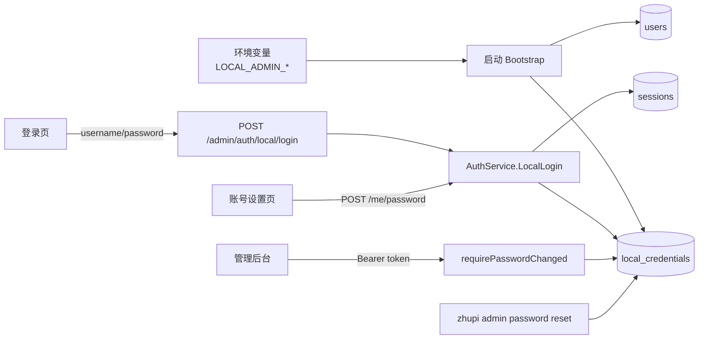

# 本地管理员账号密码登录 · Plan

> 状态：已确认（v1.0）
> 输入：`.specs/local-admin-login/spec.md`
> 目标：在不改变现有登录体系的前提下，增加单账号本地超管兜底登录。

## 1. 架构概览



**核心原则**

- 本地凭据独立建表，不污染 `users` / `identities`。
- 密码只以 bcrypt 哈希形式存在；`domain.User` 不增加密码字段。
- 强制改密通过 `Principal.MustChangePassword` 暴露给中间件与前端。
- 初始化幂等：默认只在“无本地凭据”时创建，避免重启覆盖后台密码。

## 2. 数据结构

### 2.1 迁移 `0002_local_credentials.sql`

```sql
CREATE TABLE local_credentials (
  user_id              INTEGER PRIMARY KEY REFERENCES users(id) ON DELETE CASCADE,
  username             TEXT    NOT NULL COLLATE NOCASE UNIQUE,
  password_hash        TEXT    NOT NULL,
  must_change_password INTEGER NOT NULL DEFAULT 0,
  created_at           INTEGER NOT NULL,
  updated_at           INTEGER NOT NULL
);
```

- `user_id` 主键保证一个用户最多一条本地凭据。
- `username` 使用 `NOCASE` 唯一索引，登录时大小写不敏感。
- 单行约束（只允许一个本地账号）由服务层 bootstrap 保证。

### 2.2 领域对象

```go
type LocalCredential struct {
    UserID             int64
    Username           string
    PasswordHash       string
    MustChangePassword bool
    CreatedAt          time.Time
    UpdatedAt          time.Time
}
```

`Principal` 增加：

```go
LocalUsername      string
MustChangePassword bool
```

## 3. 模块设计

### 3.1 `internal/auth/password.go`

- `HashPassword(plain string) (string, error)`：bcrypt cost 12。
- `VerifyPassword(hash, plain string) bool`：bcrypt 比对。
- `ValidatePassword(plain string) error`：8–72 字节。
- `GeneratePassword() (string, error)`：16 位 URL-safe 随机密码。
- 对不存在的账号使用固定 dummy hash 比对，降低时序差异。

### 3.2 `internal/store/local_credential_repo.go`

实现 `LocalCredentialRepo`：

- `CreateLocalCredential`
- `LocalCredentialByUsername`（`COLLATE NOCASE`）
- `LocalCredentialByUserID`
- `UpdateLocalCredentialPassword`
- `CountLocalCredentials`（bootstrap 判断是否已初始化）

`SessionRepo` 增加 `RevokeOtherSessionsForUser(ctx, userID, keepSessionID)`。

### 3.3 `internal/service/auth.go`

新增：

- `BootstrapLocalAdmin(ctx) error`
  - 无凭据：创建超管用户 + 凭据。
  - 有凭据且 `LocalAdminResetPassword`：更新哈希、吊销会话、告警。
  - 有凭据且未重置：跳过。
- `LocalLogin(ctx, username, password, meta) (LocalLoginResult, error)`
  - 查凭据 → 校验密码 → 检查封禁 → 创建 session。
  - 失败统一 401。
- `ChangePassword(ctx, userID, currentSessionID, current, next) error`
  - 校验当前密码与新密码策略 → 更新哈希 → 清除强制标记 → 吊销其他会话。
- `ResetLocalPassword(ctx, username, password) error`（CLI 复用）
  - 更新哈希、吊销全部会话。
- `AuthenticateSession` 加载本地凭据，填充 `Principal.LocalUsername` 与
  `Principal.MustChangePassword`。

### 3.4 `internal/httpapi`

- `POST /api/v1/admin/auth/local/login`：公开 + 登录限流。
- `POST /api/v1/me/password`：认证。
- `GET /api/v1/me`：返回 `username`、`mustChangePassword`。
- `GET /api/v1/admin/auth/providers`：返回 `local`。
- 新中间件 `requirePasswordChanged`：应用于所有已认证管理路由
  （`/api/v1/admin/*` 中除公开 auth 外的路由）。

### 3.5 CLI

`cmd/zhupi/main.go` 增加 `admin password reset`：

- 复用 `config.Load` + `store.Open` + `Migrate`。
- 构造只依赖 store 的 `AuthService`（未用依赖传 nil）。
- 输出新密码（仅一次）并提示已吊销会话。

### 3.6 管理后台

- `LoginView.vue`：新增本地账号密码表单（`providers.local` 为 true 时展示）。
- `AccountView.vue`：账号信息 + 修改密码表单。
- `router.ts`：新增 `/account`；守卫在 `mustChangePassword` 时只允许 `/account`。
- `stores/auth.ts`：`localLogin`、`changePassword`、`mustChangePassword` 辅助。
- `layout/AdminLayout.vue`：用户菜单增加「账号设置」。

## 4. 关键流程

### 4.1 首次启动

1. `Migrate` 创建 `local_credentials`。
2. `BootstrapLocalAdmin` 查无凭据 → 创建 `admin` 用户（超管）→ bcrypt(`admin`) 落库，
   `must_change_password = 1`。

### 4.2 首次登录

1. 登录页提交 `admin` / `admin`。
2. 服务端返回 token + `mustChangePassword: true`。
3. 前端保存 token，跳转 `/account`。
4. 其他管理路由被前端守卫拦截；直接调用管理 API 被后端 403 拦截。
5. 修改密码成功 → 清除标记 → 回概览。

### 4.3 忘记密码

1. 服务器上执行 `zhupi admin password reset --username admin`。
2. 命令打印随机密码并吊销全部会话。
3. 使用新密码登录；如需再次强制改密，重置为 `admin` 即可。

## 5. 风险与取舍

- **默认密码风险**：默认 `admin/admin` 仅用于首次引导，强制改密 + 登录限流降低风险；
  文档明确要求公网部署后立即修改。
- **每请求多一次查询**：`AuthenticateSession` 查询本地凭据。SQLite 主键查询成本低，
  当前规模可接受；后续可缓存。
- **单实例限流**：沿用现有进程内限流，多实例部署需外部限流（本期不做）。
- **环境变量重置**：必须显式 `LOCAL_ADMIN_RESET_PASSWORD=1`，避免误覆盖。

## 6. 交付物

- 数据库迁移 1 个。
- 后端：password 工具、store repo、service 方法、3 个 API、1 个中间件、CLI 子命令。
- 前端：登录页改造、账号设置页、路由守卫、API 类型。
- 测试：password 单测、service 登录/改密测试、HTTP 集成测试。
- 文档：README 环境变量与首次登录说明。
