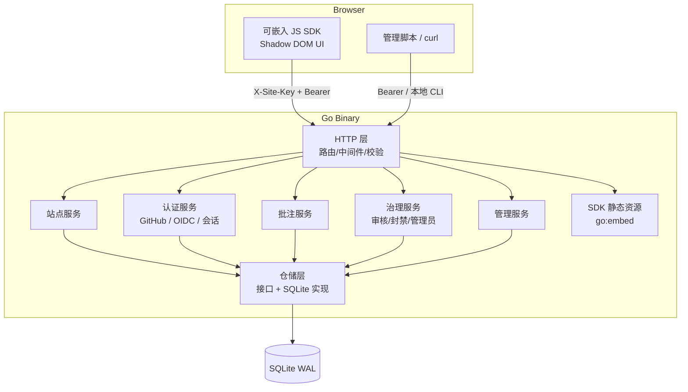
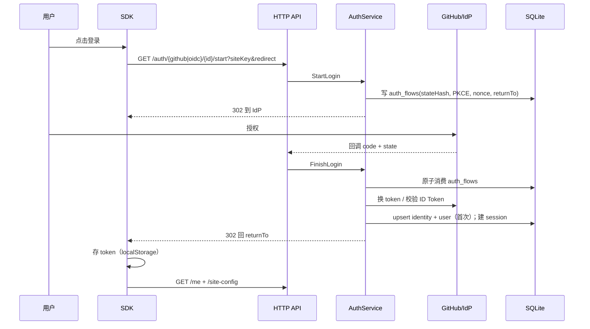
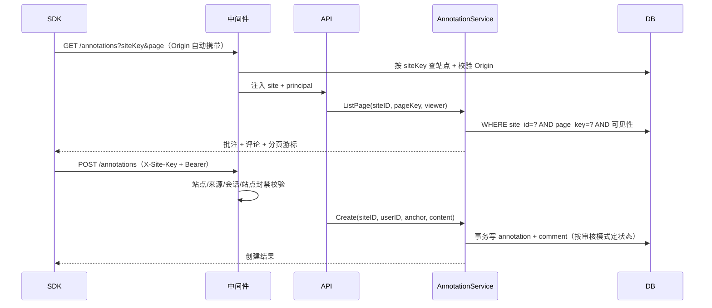
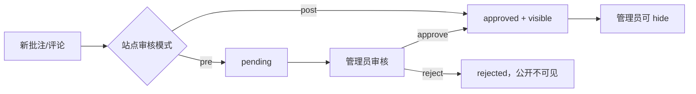

# Annotation Service 多站点划线批注产品 · Plan

> 状态：草案 v0.1（等待评审）
> 输入：`.specs/multi-site-annotation/spec.md`
> 目标：把单站点服务重构为「多站点 + 可嵌入 SDK + 两级管理」的模块化单体。

## 1. 架构概览

采用**模块化单体（Modular Monolith）**：一个 Go 二进制、一个 SQLite 数据库、一套 HTTP API。理由：

- 当前团队与流量规模不需要微服务；
- 站点隔离通过「所有仓储方法强制带 siteID」保证，比拆服务更简单可靠；
- 单二进制 + SDK 内嵌，保持自托管一键部署；
- 模块边界清晰（站点、身份、批注、治理），未来可独立拆分。



**分层规则**

- `domain`：实体与错误，不依赖数据库/HTTP。
- `store`：仓储接口 + SQLite 实现 + 迁移；所有站点级方法签名必须带 `siteID`。
- `service`：业务规则、权限判断、事务边界。
- `httpapi`：解析、鉴权、站点解析、CORS、错误映射；不写业务规则。
- `auth`：OAuth/OIDC 协议、PKCE、会话 token。
- `crypto`：AES-GCM 加密 OIDC clientSecret。
- `cmd`：组装依赖、CLI 子命令。
- `sdk`：独立 TypeScript 包，构建后内嵌进二进制。

## 2. 核心数据结构

### 2.1 实体

```go
// internal/domain

type SiteStatus string       // "active" | "disabled"
type ModerationMode string   // "post"（先发后审） | "pre"（先审后发）
type UserStatus string       // "active" | "banned"
type ProviderType string     // "github" | "oidc"
type AnnotationStatus string // "open" | "resolved"
type ModerationStatus string // "pending" | "approved" | "rejected"
type Visibility string       // "visible" | "hidden" | "deleted"

type Site struct {
	ID             int64
	Key            string        // 公开 siteKey，URL-safe 随机串，可轮换
	Name           string        // 内部名称，唯一
	DisplayName    string        // 展示名
	Status         SiteStatus
	ModerationMode ModerationMode
	ThemeColor     string
	DefaultLocale  string
	Origins        []string      // 允许的来源，精确匹配 scheme://host[:port]
	CreatedAt      time.Time
	UpdatedAt      time.Time
}

type User struct {
	ID           int64
	DisplayName  string
	AvatarURL    string
	Status       UserStatus
	IsSuperadmin bool
	CreatedAt    time.Time
}

type Identity struct {
	ID            int64
	UserID        int64
	Provider      ProviderType
	SiteID        int64    // 0 = 全局（GitHub）；OIDC 必须 > 0
	Issuer        string   // GitHub 固定 "https://github.com"
	Subject       string   // 提供商的稳定用户 ID
	Handle        string   // GitHub login / OIDC preferred_username
	Email         string
	EmailVerified bool
	AvatarURL     string
	CreatedAt     time.Time
	LastLoginAt   time.Time
}

type Session struct {
	ID         int64
	TokenHash  string // SHA-256(token)，明文只返回一次
	UserID     int64
	UserAgent  string
	IP         string
	CreatedAt  time.Time
	ExpiresAt  time.Time
	LastSeenAt time.Time
	RevokedAt  *time.Time
}

type Anchor struct {
	Quote    QuoteSelector `json:"quote"`
	Position *TextPosition `json:"position,omitempty"`
	Section  string        `json:"section,omitempty"`
}

type QuoteSelector struct {
	Type   string `json:"type"`   // 固定 TextQuoteSelector
	Exact  string `json:"exact"`
	Prefix string `json:"prefix"`
	Suffix string `json:"suffix"`
}

type TextPosition struct {
	Start int `json:"start"`
	End   int `json:"end"`
}

type Annotation struct {
	ID          int64
	SiteID      int64
	PageKey     string
	PageTitle   string
	Anchor      Anchor
	QuoteExact  string
	Section     string
	Status      AnnotationStatus
	Moderation  ModerationStatus
	Visibility  Visibility
	CreatedBy   int64
	CreatedAt   time.Time
	UpdatedAt   time.Time
	Author      Author // 关联查询填充
}

type Comment struct {
	ID         int64
	SiteID     int64
	AnnotationID int64
	UserID     int64
	Content    string
	Moderation ModerationStatus
	Visibility Visibility
	CreatedAt  time.Time
	Author     Author
}

type OIDCProvider struct {
	ID                  int64
	SiteID              int64
	Name                string
	Issuer              string
	ClientID            string
	ClientSecretCipher  []byte // AES-256-GCM(nonce||ciphertext)
	Scopes              []string
	AllowedEmailDomains []string
	Enabled             bool
	CreatedAt           time.Time
	UpdatedAt           time.Time
}

type SiteAdmin struct {
	SiteID    int64
	UserID    int64
	GrantedBy int64
	CreatedAt time.Time
}

type SiteBan struct {
	SiteID    int64
	UserID    int64
	BannedBy  int64
	Reason    string
	CreatedAt time.Time
}
```

### 2.2 仓储接口

所有站点级方法强制带 `siteID`，从类型层面阻止跨站点查询。

```go
// internal/store

type SiteRepo interface {
	Create(ctx context.Context, s domain.Site) (domain.Site, error)
	ByID(ctx context.Context, id int64) (domain.Site, error)
	ByKey(ctx context.Context, key string) (domain.Site, error)
	Update(ctx context.Context, s domain.Site) error
	RotateKey(ctx context.Context, id int64, newKey string) error
	ReplaceOrigins(ctx context.Context, siteID int64, origins []string) error
	List(ctx context.Context, cursor int64, limit int) ([]domain.Site, int64, error)
}

type UserRepo interface {
	Create(ctx context.Context, u domain.User) (domain.User, error)
	ByID(ctx context.Context, id int64) (domain.User, error)
	UpdateStatus(ctx context.Context, id int64, status domain.UserStatus) error
	SetSuperadmin(ctx context.Context, id int64, v bool) error
	List(ctx context.Context, cursor int64, limit int) ([]domain.User, int64, error)
}

type IdentityRepo interface {
	Create(ctx context.Context, i domain.Identity) (domain.Identity, error)
	ByID(ctx context.Context, id int64) (domain.Identity, error)
	ByProviderSubject(ctx context.Context, provider domain.ProviderType, siteID int64, issuer, subject string) (domain.Identity, error)
	ListByUser(ctx context.Context, userID int64) ([]domain.Identity, error)
	Delete(ctx context.Context, id, userID int64) error
	TouchLogin(ctx context.Context, id int64, t time.Time) error
}

type SessionRepo interface {
	Create(ctx context.Context, s domain.Session) error
	ByTokenHash(ctx context.Context, hash string) (domain.Session, error)
	ListByUser(ctx context.Context, userID int64) ([]domain.Session, error)
	Revoke(ctx context.Context, id, userID int64) error
	RevokeAllForUser(ctx context.Context, userID int64) error
	Touch(ctx context.Context, id int64, t time.Time) error
	PurgeExpired(ctx context.Context) error
}

type AnnotationRepo interface {
	Create(ctx context.Context, a domain.Annotation) (domain.Annotation, error)
	ByID(ctx context.Context, siteID, id int64) (domain.Annotation, error)
	ListPage(ctx context.Context, siteID int64, pageKey string, viewerID int64, includeUnapproved bool, cursor int64, limit int) ([]domain.Annotation, int64, error)
	UpdateStatus(ctx context.Context, siteID, id int64, status domain.AnnotationStatus) error
	SetVisibility(ctx context.Context, siteID, id int64, v domain.Visibility) error
	SetModeration(ctx context.Context, siteID, id int64, m domain.ModerationStatus) error
	SoftDelete(ctx context.Context, siteID, id int64) error
}

type CommentRepo interface {
	Create(ctx context.Context, c domain.Comment) (domain.Comment, error)
	ByID(ctx context.Context, siteID, id int64) (domain.Comment, error)
	ListByAnnotation(ctx context.Context, siteID, annotationID int64, includeUnapproved bool) ([]domain.Comment, error)
	SetModeration(ctx context.Context, siteID, id int64, m domain.ModerationStatus) error
	SoftDelete(ctx context.Context, siteID, id int64) error
}

type ProviderRepo interface {
	Create(ctx context.Context, p domain.OIDCProvider) (domain.OIDCProvider, error)
	ByID(ctx context.Context, siteID, id int64) (domain.OIDCProvider, error)
	ListBySite(ctx context.Context, siteID int64, onlyEnabled bool) ([]domain.OIDCProvider, error)
	Update(ctx context.Context, p domain.OIDCProvider) error
	Delete(ctx context.Context, siteID, id int64) error
}

type AdminRepo interface {
	AddSiteAdmin(ctx context.Context, a domain.SiteAdmin) error
	RemoveSiteAdmin(ctx context.Context, siteID, userID int64) error
	ListSiteAdmins(ctx context.Context, siteID int64) ([]domain.SiteAdmin, error)
	IsSiteAdmin(ctx context.Context, siteID, userID int64) (bool, error)
	BanSite(ctx context.Context, b domain.SiteBan) error
	UnbanSite(ctx context.Context, siteID, userID int64) error
	IsBanned(ctx context.Context, siteID, userID int64) (bool, error)
}

type AuthFlowRepo interface {
	Create(ctx context.Context, f domain.AuthFlow) error
	Consume(ctx context.Context, stateHash string) (domain.AuthFlow, error) // 原子删除并返回
	PurgeExpired(ctx context.Context) error
}
```

`domain.AuthFlow` 保存一次性登录流程：`stateHash、kind、mode(login|bind)、providerID、siteID、userID、returnTo、codeVerifier、nonce、expiresAt`。

### 2.3 服务接口

```go
// internal/service

type SiteService struct { sites store.SiteRepo }
func (s *SiteService) Resolve(ctx context.Context, siteKey, origin string) (domain.Site, error)
func (s *SiteService) Create(ctx context.Context, input CreateSiteInput) (domain.Site, error)
func (s *SiteService) Update(ctx context.Context, siteID int64, input UpdateSiteInput) (domain.Site, error)
func (s *SiteService) RotateKey(ctx context.Context, siteID int64) (string, error)

type AuthService struct { /* users, identities, sessions, providers, flows, oauth clients, cipher */ }
func (a *AuthService) StartGitHub(ctx context.Context, req StartLogin) (redirectURL string, err error)
func (a *AuthService) FinishGitHub(ctx context.Context, code, state string) (LoginResult, error)
func (a *AuthService) StartOIDC(ctx context.Context, providerID int64, req StartLogin) (redirectURL string, err error)
func (a *AuthService) FinishOIDC(ctx context.Context, providerID int64, code, state string) (LoginResult, error)
func (a *AuthService) StartBind(ctx context.Context, userID int64, provider ProviderRef, siteID *int64) (redirectURL string, err error)
func (a *AuthService) Authenticate(ctx context.Context, token string) (Principal, error)
func (a *AuthService) Logout(ctx context.Context, sessionID int64) error

type AnnotationService struct { /* sites, annotations, comments, moderation mode */ }
func (s *AnnotationService) ListPage(ctx context.Context, p Principal, siteID int64, pageKey string, cursor int64, limit int) (PageResult, error)
func (s *AnnotationService) Create(ctx context.Context, p Principal, siteID int64, input CreateAnnotationInput) (domain.Annotation, error)
func (s *AnnotationService) Resolve(ctx context.Context, p Principal, siteID, id int64, resolved bool) error
func (s *AnnotationService) Delete(ctx context.Context, p Principal, siteID, id int64) error
func (s *AnnotationService) AddComment(ctx context.Context, p Principal, siteID, annotationID int64, content string) (domain.Comment, error)
func (s *AnnotationService) DeleteComment(ctx context.Context, p Principal, siteID, id int64) error

type ModerationService struct { /* annotations, comments, admin repo */ }
func (m *ModerationService) ListQueue(ctx context.Context, p Principal, siteID int64, cursor int64, limit int) (Queue, error)
func (m *ModerationService) ModerateAnnotation(ctx context.Context, p Principal, siteID, id int64, action ModerationAction) error
func (m *ModerationService) ModerateComment(ctx context.Context, p Principal, siteID, id int64, action ModerationAction) error
func (m *ModerationService) BanUser(ctx context.Context, p Principal, siteID, userID int64, reason string) error
func (m *ModerationService) UnbanUser(ctx context.Context, p Principal, siteID, userID int64) error
```

`Principal` 是鉴权后的上下文：`UserID、IsSuperadmin、SiteID、IsSiteAdmin`。

## 3. 模块设计

### 3.1 站点与来源解析

**职责：** siteKey → Site；站点状态与来源白名单校验；站点 CRUD。

**规则：**

- siteKey 为 32 字节随机数的 URL-safe 编码，公开可见；轮换后旧值立即失效。
- 来源匹配精确到 `scheme://host[:port]`；V1 不支持通配符子域。
- 站点级请求必须同时满足：siteKey 存在、站点启用、Origin 在白名单内。
- `GET /api/v1/site-config` 用于 SDK 初始化，返回品牌、审核模式、可用登录方式（不含密钥）。

### 3.2 身份与认证

**GitHub（全局）：**

- 环境变量：`GITHUB_CLIENT_ID/SECRET`，回调 `/api/v1/auth/github/callback`。
- 授权码换取 token → `GET https://api.github.com/user` → `(issuer=https://github.com, subject=id)`。
- scope：`read:user`（不请求邮箱，避免自动合并语义）。

**OIDC（站点级）：**

- 站点管理员/超管配置 provider；保存时做一次 Discovery 校验。
- 使用 `github.com/coreos/go-oidc/v3/oidc` 校验 ID Token，`golang.org/x/oauth2` 完成授权码 + PKCE。
- 授权码 + PKCE(S256) + state + nonce；state 与 PKCE 校验值存 `auth_flows`，一次性消费。
- 回调地址：`/api/v1/auth/oidc/{providerID}/callback`，需在每个 IdP 注册。
- 用户信息：`sub`、`email`、`email_verified`、`name`/`preferred_username`、`picture`。
- clientSecret 用 AES-256-GCM 加密，密钥来自 `SECRET_KEY`；读取接口只返回「已配置/未配置」。

**账号与身份：**

- 首次登录：按 `(provider, siteID, issuer, subject)` 查身份；不存在则创建 `users` + `identities`。
- 默认不按邮箱合并；绑定/解绑必须已登录：
  - 绑定流程 `mode=bind`，回调后把新身份挂到当前用户；
  - 目标身份已属于其他用户 → `409 identity_already_bound`；
  - 不允许解绑最后一个身份。
- 超管：`SUPERADMIN_GITHUB_LOGINS` 中的 GitHub login 在登录时自动提升；CLI 可手动提升/撤销。

**会话：**

- 32 字节随机 token，明文只在登录回调返回一次；数据库只存 SHA-256。
- SDK 通过 URL fragment 接收 token 后存 localStorage（按 `apiBase + siteKey` 隔离）。
- 每次请求校验 token 哈希、过期、撤销、全局封禁；`last_seen_at` 最多每 5 分钟更新一次。
- 站点封禁不删除会话，但在该站点的站点级请求中直接拒绝。

### 3.3 批注与评论

**锚点：** 复用现有前端算法（`dom-anchor-text-quote` 生成/模糊定位 + `@apache-annotator/dom` 高亮），服务端只存储与校验。

**创建规则：**

- `exact` 1–2000 rune；`prefix/suffix` ≤ 500；`section` ≤ 200；内容 1–4000 rune。
- 站点审核模式决定初始 `moderation`：`post → approved`，`pre → pending`。
- 顶层批注的首条内容写入 `comments`（与现有行为一致），同事务提交。

**可见性：**

```
publicVisible = moderation == approved && visibility == visible
authorVisible = created_by == viewer.id
```

- 公开列表返回 `publicVisible OR authorVisible`；待审/拒绝内容只对作者与管理员可见。
- 管理员列表可按状态过滤，不受可见性限制。

**编辑权限：**

- 批注状态（open/resolved）：作者、站点管理员、超管。
- 隐藏/删除：站点管理员、超管；作者可删除自己的。
- 评论：作者可删自己的；站点管理员/超管可隐藏或删除任意评论。

### 3.4 审核与治理

- 站点级审核模式在 `sites.moderation_mode`。
- 审核动作：`approve`、`reject`、`hide`、`restore`。
- 封禁：
  - 全局封禁：`users.status = banned`，撤销其全部会话；
  - 站点封禁：`site_bans`，该站点内所有需要身份的操作（写批注/评论、回复、绑定、管理）返回 403；公开读取仍可作为匿名用户进行。
- 站点管理员由超管指定；站点管理员只能管理本站点。
- 审核/封禁操作写结构化日志（V1 不建审计表）。

### 3.5 管理 API 与 CLI

**管理 API（`/api/v1/admin`，Bearer + 角色校验）：**

- 超管：站点 CRUD、轮换 siteKey、指定/撤销站点管理员、全局用户列表与封禁。
- 站点管理员：本站审核队列、内容隐藏/删除、本站用户封禁、本站 OIDC 提供商 CRUD。
- 管理 API 的 CORS 默认关闭（仅 CLI/curl/受信代理）；未来管理后台通过 `ADMIN_ORIGINS` 白名单开启。

**CLI（同一二进制子命令，直接复用 service 层）：**

```
annotation-service serve
annotation-service admin migrate
annotation-service admin site create --name <name> --origin <origin> [--origin ...]
annotation-service admin site add-admin --site <siteKey> --user <userID|githubLogin>
annotation-service admin site rotate-key --site <siteKey>
annotation-service admin promote --github-login <login>
annotation-service admin users list
```

CLI 需要直接访问数据库文件，文档说明只能在服务器上执行。

### 3.6 可嵌入 SDK

独立 TypeScript 包，构建产物：

- `annotation-sdk.esm.js` + `.d.ts`（npm/ESM 使用）
- `annotation-sdk.iife.js`（`<script>` 引入，全局 `AnnotationSDK`）

由 Go 二进制通过 `go:embed` 托管在 `/sdk/v1/annotation-sdk.js`，实现「一个服务即完整产品」。

**公开 API：**

```ts
interface InitOptions {
  siteKey: string
  pageKey?: string          // 默认 location.pathname
  pageTitle?: string        // 默认 document.title
  apiBase?: string          // 默认 SDK 所在服务的 origin
  container?: HTMLElement   // 默认 document.body
  locale?: 'zh-CN' | 'en'
  theme?: 'auto' | 'light' | 'dark'
  on?: Partial<EventHandlers>
}

interface AnnotationInstance {
  setPage(page: { pageKey?: string; pageTitle?: string }): Promise<void>
  refresh(): Promise<void>
  login(providerId?: string): void
  logout(): Promise<void>
  getCurrentUser(): User | null
  on<E extends keyof EventHandlers>(event: E, handler: EventHandlers[E]): () => void
  destroy(): void
}

declare function init(options: InitOptions): AnnotationInstance
```

**内部模块：**

- `client.ts`：HTTP 客户端，自动附加 `X-Site-Key`、`Authorization`，统一错误。
- `anchor.ts`：选区校验、锚点生成、模糊定位、高亮渲染/清理。
- `state.ts`：当前用户、站点配置、批注列表、当前页。
- `ui/`：Shadow DOM 内的工具条、编辑器、侧栏、登录面板、Toast。
- `styles/`：CSS 变量 + 亮暗主题，全部封装在 Shadow Root。

**接入流程：**

1. `init({ siteKey })` → 拉 `/api/v1/site-config`；
2. 消费 URL fragment 中的会话 token（登录回跳）；
3. 拉当前页批注 → 定位高亮；
4. 监听选区 → 显示「批注」；
5. 提交后本地插入并刷新。

**SPA：** `setPage()` 清理旧高亮并重新加载；`destroy()` 移除监听、UI 与 Shadow 宿主。

**登录：** V1 使用整页跳转（`window.location.href = startUrl`），回调后带 token 回跳；弹窗/postMessage 留到 V2。

### 3.7 静态 SDK 与构建

- `sdk/` 用 Vite library mode 构建 ESM + IIFE + d.ts。
- `Makefile` 目标：
  - `make sdk` → 构建并复制到 `internal/sdkassets/dist/`
  - `make server` → `go build`
  - `make build` → 两者串行
- Dockerfile 改为多阶段：Node 构建 SDK → Go 编译（embed）→ Alpine 运行。

## 4. 模块交互

### 4.1 登录（GitHub / OIDC）



### 4.2 批注读取与写入



### 4.3 审核



## 5. HTTP API 设计

统一前缀 `/api/v1`；错误结构：

```json
{ "error": { "code": "site_not_found", "message": "站点不存在", "requestId": "..." } }
```

### 5.1 公共 / SDK

| 方法 | 路径 | 说明 |
|---|---|---|
| GET | `/healthz` | 存活 |
| GET | `/readyz` | 数据库可用 |
| GET | `/site-config` | 站点品牌、审核模式、登录方式（需 siteKey + Origin） |
| GET | `/annotations?page=&cursor=&limit=` | 分页读取页面批注 |
| POST | `/annotations` | 创建批注 |
| PATCH | `/annotations/{id}` | 解决/重新打开 |
| DELETE | `/annotations/{id}` | 作者或管理员删除 |
| POST | `/annotations/{id}/comments` | 回复 |
| DELETE | `/comments/{id}` | 作者或管理员删除 |

站点级请求头：`X-Site-Key: <key>`，浏览器自动带 `Origin`。

### 5.2 认证 / 账号

| 方法 | 路径 | 说明 |
|---|---|---|
| GET | `/auth/github/start?redirect=` | 全局 GitHub 登录/绑定 |
| GET | `/auth/github/callback` | GitHub 回调 |
| GET | `/auth/oidc/{providerID}/start?redirect=` | 站点 OIDC 登录/绑定 |
| GET | `/auth/oidc/{providerID}/callback` | OIDC 回调 |
| POST | `/auth/logout` | 撤销当前会话 |
| GET | `/me` | 当前用户 + 角色 |
| GET | `/me/identities` | 我的身份绑定 |
| DELETE | `/me/identities/{id}` | 解绑（不能解最后一个） |
| GET | `/me/sessions` | 我的活跃会话 |
| DELETE | `/me/sessions/{id}` | 撤销指定会话 |
| DELETE | `/me/sessions` | 退出所有设备 |

### 5.3 管理

| 方法 | 路径 | 角色 |
|---|---|---|
| GET/POST | `/admin/sites` | 超管 |
| GET/PATCH | `/admin/sites/{id}` | 超管 |
| POST | `/admin/sites/{id}/rotate-key` | 超管 |
| GET/POST | `/admin/sites/{id}/admins` | 超管 |
| DELETE | `/admin/sites/{id}/admins/{userID}` | 超管 |
| GET | `/admin/users` | 超管 |
| POST/DELETE | `/admin/users/{id}/ban` | 超管（全局） |
| GET | `/admin/sites/{id}/queue` | 站点管理员/超管 |
| POST | `/admin/annotations/{id}/moderate` | 站点管理员/超管 |
| POST | `/admin/comments/{id}/moderate` | 站点管理员/超管 |
| POST/DELETE | `/admin/sites/{id}/bans/{userID}` | 站点管理员/超管 |
| GET/POST | `/admin/sites/{id}/providers` | 站点管理员/超管 |
| PATCH/DELETE | `/admin/providers/{id}` | 站点管理员/超管 |

### 5.4 中间件链

```
recover → requestID → slog → bodyLimit → CORS → rateLimit
        → siteResolve（站点级路由）→ authenticate（可选/必需）
        → requireRole（管理路由）→ handler
```

- `siteResolve`：读 `X-Site-Key`，查站点、校验启用与 Origin，注入 `SiteContext`。
- `authenticate`：解析 Bearer，校验会话、过期、撤销、全局封禁；注入 `Principal`。
- 站点封禁在该站点的写操作中额外校验。
- CORS：站点来源动态放行；`Access-Control-Allow-Headers` 含 `Authorization, Content-Type, X-Site-Key`。
- 限流：写操作按用户/IP，读操作按 IP；进程内令牌桶，单实例前提。

## 6. 数据模型与迁移

### 6.1 表清单

| 表 | 关键字段 | 说明 |
|---|---|---|
| `sites` | id, key(uniq), name(uniq), display_name, status, moderation_mode, theme_color, default_locale | 站点 |
| `site_origins` | site_id, origin | 来源白名单，唯一约束 |
| `users` | id, display_name, avatar_url, status, is_superadmin | 全局用户 |
| `identities` | id, user_id, provider, site_id(0=全局), issuer, subject, handle, email, email_verified | 唯一(provider, site_id, issuer, subject) |
| `sessions` | token_hash(PK), user_id, expires_at, revoked_at, last_seen_at | 会话 |
| `site_admins` | site_id, user_id | 唯一约束 |
| `site_bans` | site_id, user_id, reason | 唯一约束 |
| `oidc_providers` | id, site_id, issuer, client_id, client_secret_cipher, scopes, allowed_email_domains, enabled | 站点 OIDC |
| `auth_flows` | state_hash(PK), kind, mode, provider_id, site_id, user_id, return_to, code_verifier, nonce, expires_at | 一次性登录流程 |
| `annotations` | id, site_id, page_key, page_title, anchor_json, quote_exact, section, status, moderation, visibility, created_by | 索引(site_id,page_key) |
| `comments` | id, site_id, annotation_id, user_id, content, moderation, visibility | 索引(site_id,annotation_id) |
| `schema_migrations` | version, applied_at | 迁移版本 |

### 6.2 迁移策略

- SQL 文件放在 `internal/store/migrations/0001_init.sql` 起，按文件名排序执行。
- 启动时在事务内检查并应用，记录到 `schema_migrations`；可重复执行。
- 现有单站点库不迁移：检测到旧表结构时提示使用新数据库文件（V1 明确不兼容）。

## 7. 文件组织

```
annotation-service/
├── cmd/annotation-service/
│   └── main.go                  — 子命令：serve / admin
├── internal/
│   ├── config/config.go         — 环境变量与校验
│   ├── domain/                  — 实体、枚举、错误
│   ├── store/
│   │   ├── store.go             — 打开 SQLite、事务、迁移
│   │   ├── migrations/*.sql
│   │   ├── site_repo.go
│   │   ├── user_repo.go
│   │   ├── identity_repo.go
│   │   ├── session_repo.go
│   │   ├── annotation_repo.go
│   │   ├── comment_repo.go
│   │   ├── provider_repo.go
│   │   ├── admin_repo.go
│   │   └── authflow_repo.go
│   ├── auth/
│   │   ├── github.go            — 全局 GitHub OAuth
│   │   ├── oidc.go              — 站点 OIDC + PKCE
│   │   ├── session.go           — token 生成/哈希
│   │   └── flow.go              — auth_flows 生命周期
│   ├── crypto/secretbox.go      — AES-256-GCM
│   ├── service/
│   │   ├── site.go
│   │   ├── auth.go
│   │   ├── annotation.go
│   │   ├── moderation.go
│   │   └── admin.go
│   ├── httpapi/
│   │   ├── router.go
│   │   ├── middleware.go
│   │   ├── errors.go
│   │   ├── site_handlers.go
│   │   ├── auth_handlers.go
│   │   ├── annotation_handlers.go
│   │   ├── admin_handlers.go
│   │   └── sdk_handlers.go
│   ├── ratelimit/limiter.go
│   └── sdkassets/               — go:embed 构建产物
├── sdk/
│   ├── package.json
│   ├── tsconfig.json
│   ├── vite.config.ts
│   └── src/
│       ├── index.ts             — init / 实例
│       ├── client.ts
│       ├── anchor.ts
│       ├── state.ts
│       ├── events.ts
│       ├── ui/                  — 工具条、编辑器、侧栏、登录
│       └── styles/
├── examples/plain-html/         — 无框架接入示例（E2E 用）
├── deploy/                      — Caddy/Nginx/systemd
├── .specs/multi-site-annotation/
├── Dockerfile                   — Node(SDK) → Go → Alpine
├── docker-compose.yml
├── Makefile
└── go.mod
```

外部集成（另一个仓库）：
`../go-campus/docs/.vitepress/theme/` 删除手写批注层，改为加载 `/sdk/v1/annotation-sdk.js` 并 `AnnotationSDK.init({ siteKey })`。

## 8. 技术决策

| 决策点 | 选择 | 理由 |
|---|---|---|
| 部署形态 | 模块化单体 | 单实例、SQLite、自托管；隔离靠代码约束而非网络边界 |
| 存储 | SQLite + 仓储接口 | 部署最简；未来可替换 PostgreSQL |
| 站点标识 | 公开 siteKey + 来源白名单 | 与 Artalk 一致；前端可安全暴露；轮换可控 |
| 站点隔离 | 仓储方法强制 siteID | 从类型层面防止漏加条件；配跨站测试 |
| 登录凭证 | Bearer token + localStorage | SDK 可跨域使用，避免第三方 Cookie 限制 |
| 会话存储 | 只存 SHA-256 哈希 | 数据库泄露不直接泄露会话 |
| OAuth state | 服务端 `auth_flows` 表 | 支持 PKCE/nonce/一次性消费，优于无状态签名 |
| OIDC | go-oidc + oauth2 + PKCE | 标准实现，支持 Discovery 与 ID Token 校验 |
| 身份合并 | 默认不合并，手动绑定 | 防止站点级 IdP 伪造邮箱接管账号 |
| 全局身份 site_id | 用 0 代替 NULL | SQLite 的 UNIQUE 不把多个 NULL 视为重复，会破坏 GitHub 身份唯一性 |
| OIDC 密钥 | AES-256-GCM 加密存储 | 满足站点级 clientSecret 的静态加密 |
| 审核模型 | moderation + visibility 双字段 | 审核状态与管理员隐藏解耦，便于恢复 |
| SDK 分发 | 构建后 go:embed，由服务托管 | 一个服务即完整产品；同时保留 npm 构建产物 |
| SDK UI | Shadow DOM | 不污染宿主样式，适配任意前端 |
| 登录交互 | V1 整页跳转 | 实现简单可靠；弹窗/postMessage 留到 V2 |
| 管理端 | REST + CLI，无 Web UI | 控制 V1 范围；为 V2 后台预留 API |
| 分页 | id 游标 | 比 offset 稳定，避免翻页重复/遗漏 |
| 超管引导 | `SUPERADMIN_GITHUB_LOGINS` + CLI | 无需预置账号；首个 GitHub 登录即可提权 |
| 站点页面表 | V1 不建 pages 表 | 按 `(site_id,page_key)` 聚合足够；管理端 GROUP BY |
| 旧数据 | 不迁移 | 仓库尚无提交；新库结构完全不同 |

## 9. Spec 覆盖检查

| Spec | 架构归属 |
|---|---|
| F1 站点管理 | `SiteService` + `/admin/sites` + CLI |
| F2 站点隔离与来源 | 仓储强制 siteID + `siteResolve` 中间件 + 跨站测试 |
| F3 可嵌入 SDK | `sdk/` + Shadow DOM + `go:embed` |
| F4 批注与锚点 | `AnnotationService` + `anchor` 模块 |
| F5 评论 | `AnnotationService` + `CommentRepo` |
| F6 登录与账号 | `AuthService` + 全局 GitHub + 会话/身份绑定 |
| F7 站点级 OIDC | `ProviderRepo` + `auth/oidc.go` + AES-GCM |
| F8 管理与治理 | `ModerationService` + `/admin/*` + CLI |
| F9 审核策略 | `sites.moderation_mode` + `ModerationService` |
| F10 页面标识 | `(site_id,page_key)` + SDK `setPage` |
| F11 API 约定 | 中间件链 + 统一错误 + 游标分页 + 限流 |
| F12 运维与数据 | 迁移机制 + 健康检查 + Docker + 备份文档 |

## 10. 风险与待确认

1. **跨域 token 存储**：localStorage 有 XSS 面；V1 通过纯文本渲染与 SDK 样式隔离降低风险，V2 可评估同域 Cookie 代理方案。
2. **OIDC 提供商差异**：不同 IdP 的 claim 名称不一致（`preferred_username`/`name`/`picture`），需要兼容回退。
3. **SDK 内嵌进 Go 二进制**：构建链变成 Node + Go；Docker 多阶段已覆盖，但本地开发需 Node。
4. **单实例限流**：进程内令牌桶在多实例下失效；V1 明确单实例。
5. **需要确认**：站点 OIDC 提供商是否允许站点管理员自行配置（当前设计允许）；超级管理员是否可通过管理 API 强制让某用户下线（当前仅封禁会撤销会话，未提供单独强制下线接口）。
