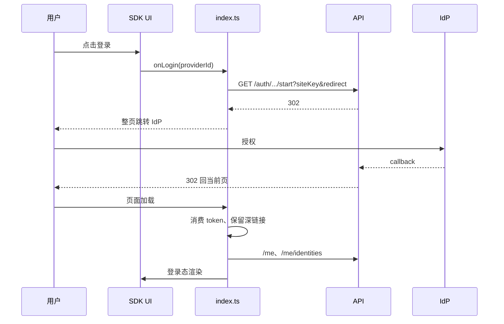
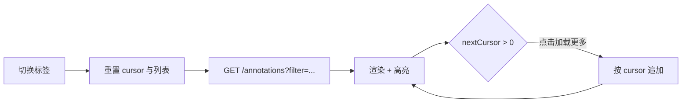
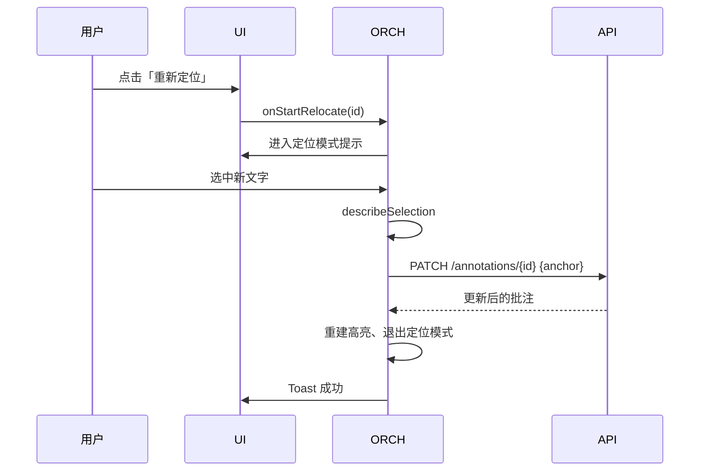
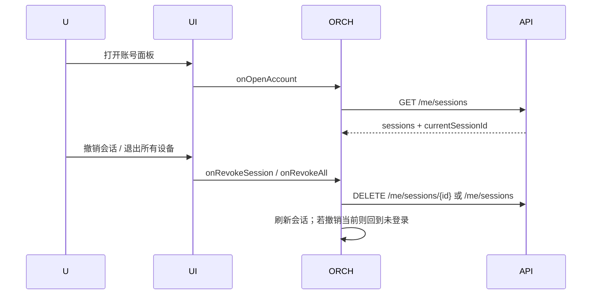

# Annotation SDK 用户端体验完善 · Plan

> 状态：草案 v0.1（等待评审）
> 输入：`.specs/sdk-experience/spec.md`
> 目标：在现有零依赖 SDK 上增量完善，并补三项最小后端能力。

## 1. 架构概览

保持「可嵌入 Widget + 模块化单体服务」不变，只在前端内部做模块化拆分，后端做三处小扩展。

```mermaid
flowchart TB
  subgraph SDK
    ORCH[index.ts<br/>实例编排]
    STATE[state.ts<br/>状态模型]
    CLIENT[client.ts<br/>HTTP/Token]
    ANCHOR[anchor.ts<br/>锚点/高亮]
    THEME[theme.ts<br/>主题偏好]
    LINK[deeplink.ts<br/>#annot-id]
    subgraph UI
      HOST[ui/host.ts<br/>Shadow DOM/CSS 变量]
      TOOLBAR[ui/toolbar.ts]
      COMPOSER[ui/composer.ts]
      DRAWER[ui/drawer.ts]
      ACCOUNT[ui/account.ts]
      CONFIRM[ui/confirm.ts]
      TOAST[ui/toast.ts]
      FOCUS[ui/focus-trap.ts]
      UI[ui/ui.ts<br/>门面]
    end
  end

  subgraph Backend
    API[HTTP API]
    SVC[AnnotationService]
    REPO[SQLite Repo]
  end

  ORCH --> CLIENT
  ORCH --> ANCHOR
  ORCH --> STATE
  ORCH --> THEME
  ORCH --> LINK
  ORCH --> UI
  UI --> HOST & TOOLBAR & COMPOSER & DRAWER & ACCOUNT & CONFIRM & TOAST & FOCUS
  CLIENT --> API
  API --> SVC --> REPO
```

**分层规则**

- `index.ts` 只做编排：生命周期、选区、状态更新、调用 UI；不直接操作 DOM 结构。
- `state.ts` 只定义状态与更新辅助函数，不依赖 UI。
- `client.ts` 只负责 HTTP、token、错误映射。
- `anchor.ts` 只负责选区描述、模糊定位、高亮与清理。
- `ui/*` 只负责渲染与事件回调；所有业务动作通过回调交给 `index.ts`。
- 后端保持 `httpapi → service → store` 分层，新增能力不破坏现有接口。

## 2. 核心数据结构

### 2.1 SDK 状态

```ts
type Filter = 'all' | 'mine' | 'resolved' | 'pending'
type ThemeMode = 'auto' | 'light' | 'dark'

type SessionView = {
  id: number
  userAgent: string
  ip: string
  createdAt: string
  lastSeenAt: string
  expiresAt: string
  current: boolean
}

type IdentityView = {
  id: number
  provider: 'github' | 'oidc' | 'dev'
  siteId: number
  issuer: string
  handle: string
  email?: string
  createdAt: string
  lastLoginAt: string
}

type ProviderView = {
  id: number
  type: 'github' | 'oidc'
  name: string
  issuer?: string
}

type SDKState = {
  siteConfig: SiteConfig | null
  user: User | null
  identities: IdentityView[]
  sessions: SessionView[]
  annotations: Annotation[]
  orphans: Set<number>
  activeId: number | null
  filter: Filter
  nextCursor: number
  loading: boolean
  loadingMore: boolean
  error: string
  drawerOpen: boolean
  accountOpen: boolean
  theme: ThemeMode
  locale: 'zh-CN' | 'en'
}
```

### 2.2 UI 门面接口

```ts
interface UIHandlers {
  onAnnotate(): void
  onCopyQuote(text: string): void
  onLogin(providerId: number): void
  onDevLogin(): void
  onLogout(): void
  onSubmitAnnotation(text: string): void
  onCancelComposer(): void
  onReply(id: number, text: string): void
  onResolve(annotation: Annotation): void
  onDelete(annotation: Annotation): void
  onDeleteComment(id: number): void
  onFocus(id: number): void
  onCopyLink(id: number): void
  onStartRelocate(id: number): void
  onFilterChange(filter: Filter): void
  onLoadMore(): void
  onOpenAccount(): void
  onBind(providerId: number): void
  onUnbind(identityId: number): void
  onRevokeSession(sessionId: number): void
  onRevokeAllSessions(): void
  onThemeChange(theme: ThemeMode): void
  onCloseDrawer(): void
}

class AnnotationUI {
  constructor(container, handlers, options)
  setState(state: SDKState): void
  setLocale(locale): void
  showToolbar(rect, actions): void
  hideToolbar(): void
  openComposer(quote: string): void
  closeComposer(): void
  setComposerPending(pending: boolean): void
  setComposerError(message: string): void
  setRelocateMode(active: boolean, quote?: string): void
  openDrawer(): void
  closeDrawer(): void
  confirm(options: ConfirmOptions): Promise<boolean>
  toast(message: string, kind?: 'success' | 'error'): void
  announce(message: string): void
  focusAnnotationCard(id: number): void
  destroy(): void
}
```

### 2.3 后端新增接口与类型

```go
// service
type ListFilter string
const (
  FilterAll      ListFilter = "all"
  FilterMine     ListFilter = "mine"
  FilterResolved ListFilter = "resolved"
  FilterPending  ListFilter = "pending"
)

type ListInput struct {
  PageKey string
  Filter  ListFilter
  Cursor  int64
  Limit   int
}

type UpdateAnnotationInput struct {
  Status *domain.AnnotationStatus
  Anchor *domain.Anchor
}

func (s *AnnotationService) ListPage(ctx, p, site, in ListInput) (PageResult, error)
func (s *AnnotationService) Update(ctx, p, siteID, id int64, in UpdateAnnotationInput) (domain.Annotation, error)
```

```go
// store
type AnnotationQuery struct {
  SiteID            int64
  PageKey           string
  ViewerID          int64
  Filter            domain.ListFilter
  IncludeUnapproved bool
  Cursor            int64
  Limit             int
}

type AnnotationRepo interface {
  // 新增/调整
  ListAnnotations(ctx, q AnnotationQuery) ([]domain.Annotation, int64, error)
  UpdateAnnotationAnchor(ctx, siteID, id int64, anchor domain.Anchor) error
  // 其余保持
}
```

HTTP：

- `GET /api/v1/annotations?page=&filter=all|mine|resolved|pending&cursor=&limit=`
- `PATCH /api/v1/annotations/{id}` 接受 `{ "status": "open|resolved" }`、
  `{ "anchor": {...} }` 或两者同时；返回更新后的批注。
- `GET /api/v1/site-config` 的 `providers[]` 增加可选 `issuer`（仅 OIDC，非敏感）。

## 3. 模块设计

### 3.1 状态与编排（`state.ts` + `index.ts`）

**职责：** 维护页面/筛选/分页/登录状态；把 UI 回调翻译成 client 调用；维护高亮与选区。

关键流程：

- `start()`：消费 hash token → 拉 site-config → 应用主题/locale → 拉 me → 拉首屏列表 → 解析深链接 → 渲染。
- `loadList(reset)`：根据 filter 生成请求；`reset` 时清空列表与高亮；追加时按 id 去重。
- `setPage()`：清空高亮与 activeId，重置 cursor，重新加载。
- `relocate`：进入定位模式后，下一次选区不走批注流程，而是更新锚点。

### 3.2 UI 组件

#### `ui/host.ts`
- 创建宿主 `<div class="annotation-sdk-host">` 与 Shadow Root。
- 注入样式；设置 CSS 变量（`--annotation-accent` 等）。
- 管理主题属性 `data-theme` 与 `prefers-color-scheme` 监听。
- 提供 `$` 查询与销毁。

#### `ui/toolbar.ts`
- 选区浮动工具条：批注、复制引用。
- 位置计算避让视口边缘与移动端键盘；`role="toolbar"`。
- 支持键盘触发（获得焦点后 Enter）。

#### `ui/composer.ts`
- 引用文本、textarea、字数计数、发布/取消、错误区。
- Ctrl/Cmd+Enter 发布；pending 时禁用；Esc 取消。
- 用于新建批注。

#### `ui/drawer.ts`
- 头部：标题、数量、筛选标签、账号入口、关闭。
- 列表：卡片、加载骨架、空态、错误重试、加载更多。
- 窄屏切换底部面板样式。
- 卡片操作：回复、解决/重新打开、删除、复制链接、重新定位。
- 待审/拒绝/已解决/orphan 徽章。

#### `ui/account.ts`
- 账号信息、退出。
- 身份列表：provider 名称、handle/email、绑定时间、解绑。
- 绑定入口：根据 site-config provider 与已绑定 issuer 过滤。
- 会话列表：当前标记、UA/IP、最后活跃、撤销单个/全部。
- 封禁状态提示。

#### `ui/confirm.ts`
- 基于 Promise 的确认框（标题、说明、危险色）。
- 焦点陷阱、Esc 取消、确认后返回焦点。

#### `ui/toast.ts`
- 成功/错误 Toast；自动消失；`aria-live="polite"` 播报。

#### `ui/focus-trap.ts`
- 通用焦点陷阱：Tab 循环、Esc 回调、关闭后恢复触发元素焦点。

#### `ui/ui.ts`
- 组合以上组件，暴露 `setState` 等门面方法；不包含业务规则。

### 3.3 主题与偏好（`theme.ts`）

- 优先级：`init.theme` > 本地偏好 > `auto`。
- 本地偏好按 `apiBase + siteKey` 存储。
- `auto` 监听 `prefers-color-scheme`。
- 暴露 CSS 变量：`--annotation-accent`、`--annotation-bg`、`--annotation-fg`、
  `--annotation-border`、`--annotation-soft`、`--annotation-danger`。
- 仅向宿主文档注入 `mark.annot-mark` 样式，其余样式封装在 Shadow Root。

### 3.4 深链接（`deeplink.ts`）

- 解析/生成 `#annot-<id>`；不影响其他 hash 参数（如 `annot_token`）。
- 登录回调 token 与深链接可共存：先消费 token，再保留 `annot-<id>` 以便定位。
- 复制链接使用当前 `location.href` 去掉 token、替换 hash。
- 剪贴板失败时返回文本供 UI 降级展示。

### 3.5 国际化与格式化

- `i18n.ts` 扩展：筛选、账号、会话、确认框、重定位、复制链接、错误文案。
- 相对时间使用 `Intl.RelativeTimeFormat`；绝对时间使用 `Intl.DateTimeFormat`。
- 文案选择：`init.locale` > site-config `locale` > `zh-CN`。
- UI 在 site-config 到达后可 `setLocale` 重建文案，不重建 DOM。

### 3.6 后端扩展

#### 列表筛选

`AnnotationService.ListPage` 将 filter 转成仓储查询：

- `all`：公开可见 + 作者本人可见（与当前行为一致）。
- `mine`：要求登录，仅 `created_by = viewer`，包含待审/已拒绝，排除已删除。
- `resolved`：公开可见 + 作者本人可见，且 `status = resolved`。
- `pending`：要求登录，仅 `created_by = viewer AND moderation = pending`。
- 站点管理员/超管通过 `IncludeUnapproved` 仍可看到全部（保持管理能力）。

#### 锚点更新

`AnnotationService.Update`：

- 若包含 `Status`：作者、站点管理员、超管可改。
- 若包含 `Anchor`：作者、站点管理员、超管可改；复用 `validateAnchor`；更新
  `anchor_json`、`quote_exact`、`section`、`updated_at`。
- 两者都为空 → 400。
- 返回更新后的批注（含 comments）。

#### site-config issuer

- `authProviderView` 增加 `issuer`（OIDC 提供商），用于 SDK 判断已绑定身份。
- GitHub 不返回 issuer 或返回空字符串。

## 4. 模块交互

### 4.1 登录



### 4.2 筛选与分页



### 4.3 orphan 重定位



### 4.4 会话撤销



## 5. 文件组织

```
annotation-service/
├── internal/
│   ├── service/
│   │   ├── annotation.go        — ListPage 增加 filter；新增 Update(anchor/status)
│   │   └── annotation_test.go   — 筛选、锚点更新、权限
│   ├── store/
│   │   ├── annotation_repo.go   — ListAnnotations(AnnotationQuery)、UpdateAnnotationAnchor
│   │   └── interfaces.go        — 更新仓储接口
│   └── httpapi/
│       ├── annotation_handlers.go — GET filter、PATCH body 扩展
│       └── site_handlers.go       — providers[].issuer
├── sdk/src/
│   ├── index.ts                 — 编排（重构）
│   ├── state.ts                 — 状态模型与更新
│   ├── client.ts                — 新增 filter/sessions/anchor 更新
│   ├── anchor.ts                — 保持，补充重定位辅助
│   ├── events.ts                — 事件扩展
│   ├── i18n.ts                  — 文案扩展
│   ├── theme.ts                 — 主题偏好
│   ├── deeplink.ts              — #annot-id
│   ├── utils/format.ts          — 相对时间、首字母
│   ├── ui/
│   │   ├── ui.ts                — 门面
│   │   ├── host.ts              — Shadow DOM/CSS 变量
│   │   ├── toolbar.ts
│   │   ├── composer.ts
│   │   ├── drawer.ts
│   │   ├── account.ts
│   │   ├── confirm.ts
│   │   ├── toast.ts
│   │   ├── focus-trap.ts
│   │   └── styles.css
│   └── **/*.test.ts
├── sdk/e2e/
│   ├── sdk.spec.ts              — 主流程
│   ├── account.spec.ts          — 身份/会话
│   └── mobile.spec.ts           — 移动端
└── examples/plain-html/index.html
```

## 6. 技术决策

| 决策点 | 选择 | 理由 |
|---|---|---|
| SDK 形态 | 现有零依赖 SDK 增量重构 | 不给接入方增加框架运行时；保持 ESM/IIFE |
| UI 拆分 | 按组件拆分 `ui/*` | 现有单文件已 400+ 行，产品级会继续膨胀 |
| 状态管理 | 显式 `SDKState` + 不可变更新 | 无框架依赖，便于测试与调试 |
| 登录 | 整页跳转 + provider 选择面板 | 移动端稳定、回调简单；弹窗留后续 |
| 列表筛选 | 服务端筛选参数 | 分页下客户端筛选会漏数据 |
| 分页 | cursor + 加载更多按钮 | 稳定、可访问；不做无限滚动 |
| orphan 重定位 | 重新选中文字 + PATCH 锚点 | 复用现有锚定逻辑，用户可控 |
| 确认框 | SDK 内 Promise 对话框 | 不调用 `window.confirm`，可主题化/可访问 |
| 深链接 | `#annot-<id>` | 简单、无需后端路由；不携带 token |
| 主题偏好 | 按 apiBase+siteKey 存 localStorage | 多站点互不影响 |
| locale 切换 | UI 门面 `setLocale` 重渲染文案 | 不重建 DOM，避免闪动 |
| 主题样式 | Shadow DOM + CSS 变量 | 不污染宿主；允许定制 |
| 高亮样式 | 注入宿主 `<style>` | `<mark>` 在 light DOM，Shadow 样式无法覆盖 |
| 后端锚点更新 | 复用 `validateAnchor` 与现有权限 | 不新增表结构 |
| 后端筛选 | 在仓储 SQL 中组合条件 | 保证全量数据正确分页 |
| 测试 | Vitest + Playwright + Go 集成测试 | 覆盖纯逻辑、交互与跨站行为 |

## 7. Spec 覆盖检查

| Spec | 架构归属 |
|---|---|
| F1 登录与账号入口 | `index.ts` 登录编排 + `ui/login`（合入 account/drawer） |
| F2 账号中心 | `ui/account.ts` + `/me/identities`、`/me/sessions` |
| F3 列表筛选分页 | `state.ts` + `client.ts` + 后端 filter |
| F4 批注评论交互 | `ui/composer.ts` / `drawer.ts` + `confirm.ts` |
| F5 orphan 重定位 | `index.ts` 定位模式 + 后端 PATCH anchor |
| F6 移动端 | `ui/drawer.ts` 响应式 + `toolbar.ts` 位置 |
| F7 可访问性 | `focus-trap.ts` + `toast.ts` aria-live + mark 键盘 |
| F8 主题/品牌/i18n | `theme.ts` + `host.ts` CSS 变量 + `i18n.ts` |
| F9 深链接 | `deeplink.ts` |
| F10 生命周期/API | `index.ts` 编排 + `events.ts` |
| F11 后端补充 | service/store/httpapi 三处扩展 |

## 8. 风险与待确认

1. **长按选区的兼容性**：移动端浏览器 `touchend` 与系统选择菜单时序不同，需要
   `selectionchange` 防抖 + 实际设备验证。
2. **焦点陷阱**：Shadow DOM 内的焦点陷阱在不同浏览器行为有差异，需要 Playwright 覆盖。
3. **IIFE 体积**：新增 UI 与逻辑可能接近 100KB gzip；若超出，优先移除重复文案/辅助代码，
   不引入新依赖。
4. **筛选语义**：「我的」是否包含自己已拒绝/隐藏的内容？当前设计包含（排除已删除），
   需在实现时用测试固定。
5. **重定位权限**：站点管理员在 SDK 中通常看不到他人批注的管理操作，但后端允许其重定位；
   SDK 只在 orphan 卡片上对作者展示入口，管理员暂通过管理 API 操作。
