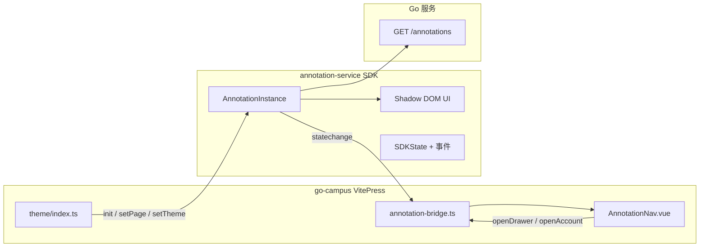
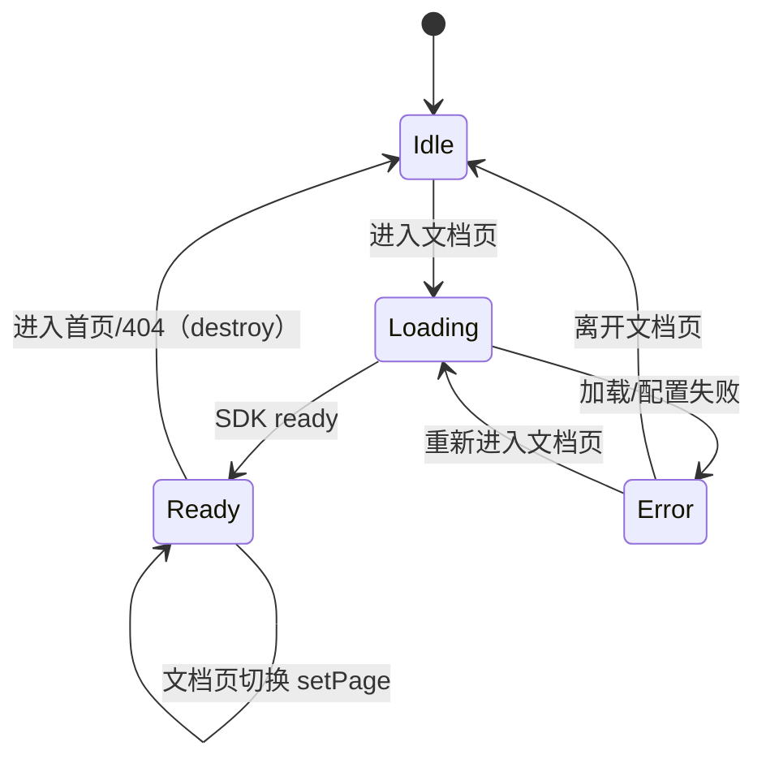
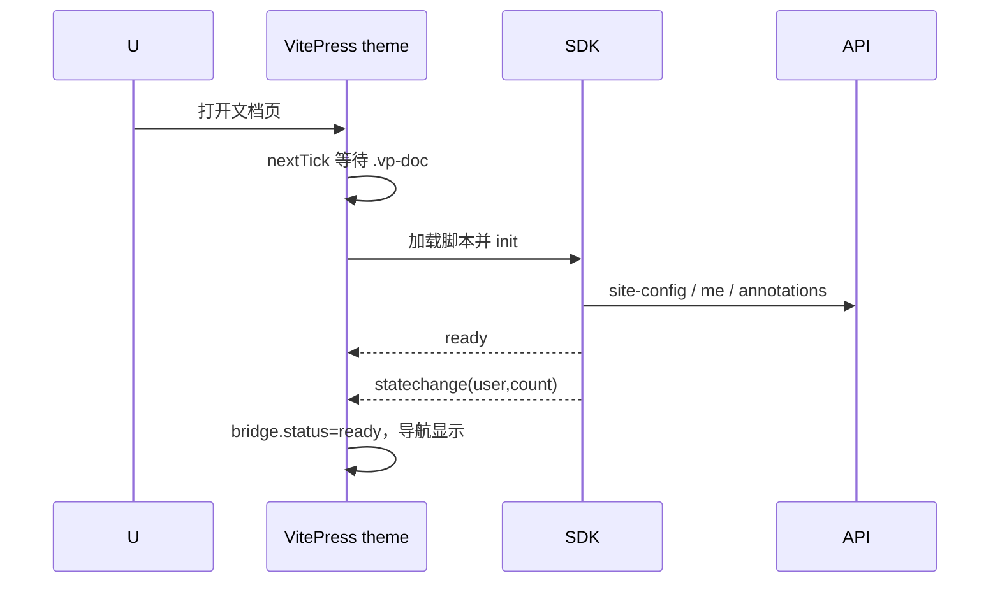
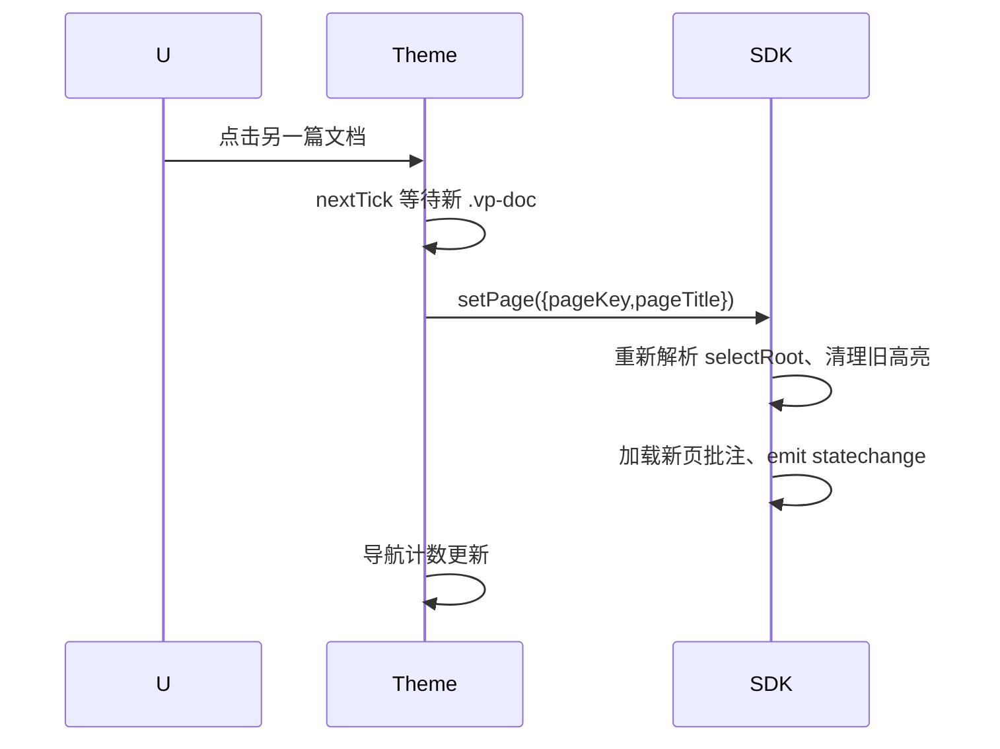
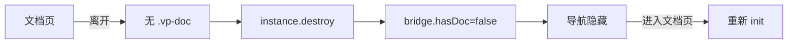

# VitePress 站内接入打磨 · Plan

> 状态：草案 v0.1（等待评审）
> 输入：`.specs/vitepress-integration/spec.md`
> 目标：SDK 少量公共 API + 后端 total + 博客单实例/导航/暗色/布局融合。

## 1. 架构概览



- 博客只负责生命周期与导航展示；所有批注 UI 仍在 SDK Shadow DOM 内。
- SDK 通过 `statechange` 把用户与页面批注总数同步给博客导航。
- 列表接口新增 `total`，作为导航计数的唯一来源。

## 2. 核心数据结构

### 2.1 后端

```go
type PageResult struct {
	Annotations []domain.Annotation `json:"annotations"`
	NextCursor  int64               `json:"nextCursor"`
	Total       int                 `json:"total"`
}
```

```go
type AnnotationRepo interface {
	// 新增
	CountPageAnnotations(ctx context.Context, siteID int64, pageKey string, viewerID int64, includeUnapproved bool) (int, error)
	// 现有
	// ...
}
```

计数 SQL 与 `filter=all` 的可见性一致，但忽略状态筛选与分页：

```sql
SELECT COUNT(*)
FROM annotations a
WHERE a.site_id = ?
  AND a.page_key = ?
  AND a.visibility <> 'deleted'
  AND ((a.moderation = 'approved' AND a.visibility = 'visible')
       OR a.created_by = ?
       OR ? = 1)
```

### 2.2 SDK 状态与事件

```ts
type SDKState = {
  // ...
  total: number // 当前页全部可见批注数
}

type EventMap = {
  // ...
  statechange: {
    user: User | null
    annotationCount: number
    loggedIn: boolean
  }
}
```

```ts
type InitOptions = {
  // ...
  cssVariables?: Record<string, string>
}
```

### 2.3 博客桥接状态

```ts
type BridgeStatus = 'idle' | 'loading' | 'ready' | 'error'

const annotationBridge = reactive({
  status: 'idle' as BridgeStatus,
  hasDoc: false,
  user: null as User | null,
  count: 0,
  actions: {
    openDrawer: () => {},
    openAccount: () => {},
  },
})
```

## 3. 后端设计

### 3.1 列表 total

- `AnnotationService.ListPage` 在查询列表后调用 `CountPageAnnotations`。
- 计数不受 `filter`、`status`、`cursor` 影响，只受站点、pageKey、当前用户可见性影响。
- 普通用户只统计公开可见 + 自己的内容；站点管理员/超管包含全部非删除内容。
- 空页返回 `total: 0`。
- 列表与计数不放在同一事务中；V1 允许极小的瞬时不一致。

### 3.2 测试

- 仓储/服务测试：
  - 公开可见 3 条、待审 1 条（他人）→ 匿名 total=3，作者 total=4，管理员 total=4。
  - filter=mine/resolved/pending 时 total 不变。
  - 分页时 total 不变。
- HTTP 集成测试覆盖响应字段。

## 4. SDK 设计

### 4.1 公共实例 API

```ts
interface AnnotationInstance {
  setPage(page): Promise<void>
  refresh(): Promise<void>
  login(providerId?: number): void
  logout(): Promise<void>
  getCurrentUser(): User | null
  getAnnotationCount(): number
  setTheme(mode: 'auto' | 'light' | 'dark'): void
  openDrawer(): void
  openAccount(): void
  on(event, handler): () => void
  destroy(): void
}
```

- `setTheme` 更新状态、调用 UI 主题并持久化偏好；由博客暗色开关调用。
- `openDrawer` / `openAccount` 直接调用 UI 门面；未初始化时安全空操作。
- `getAnnotationCount` 返回 `state.total`。
- 现有 API 与事件语义不变。

### 4.2 selectRoot 重新解析

- 构造时保存原始 `selectRoot` 选项（选择器或元素）。
- 新增 `resolveSelectRoot()`：
  - 字符串 → 每次 `querySelector`；
  - 元素 → 继续使用；若已脱离 DOM，回退 `document.body`。
- `setPage` 与 `loadList(reset)` 在计算高亮前重新解析。
- VitePress 路由切换后 `.vp-doc` 是新节点，因此必须重新解析。

### 4.3 statechange 事件

- 新增 `commitState()`：
  ```ts
  private commitState(): void {
    this.ui.setState(this.state)
    this.emitter.emit('statechange', {
      user: this.state.user,
      annotationCount: this.state.total,
      loggedIn: !!this.state.user,
    })
  }
  ```
- 将现有 `this.ui.setState(this.state)` 调用替换为 `commitState()`。
- 事件可能随加载状态变化而触发，但 `annotationCount` 使用 total，保持稳定。
- 登录/退出、列表刷新、创建/删除后导航同步更新。

### 4.4 CSS 变量

- `Host` 支持把 `init.cssVariables` 写到宿主元素 style。
- 抽屉：
  ```css
  .drawer {
    top: var(--annotation-drawer-top, 0);
    height: calc(100vh - var(--annotation-drawer-top, 0px));
  }
  ```
- FAB：
  ```css
  .fab {
    bottom: var(--annotation-fab-bottom, 24px);
    right: var(--annotation-fab-right, 20px);
  }
  ```
- 移动端媒体查询保持底部面板与安全区行为。

### 4.5 客户端与状态

- `client.listAnnotations` 返回 `{ annotations, nextCursor, total }`。
- `loadList`：
  - reset 时 `total = result.total`；
  - append 时保持 `total`（或使用响应 total，二者应相等）；
  - `commitState()`。
- `initialState` 增加 `total: 0`。
- 单元测试：total 透传、statechange 载荷。

## 5. 博客接入设计

### 5.1 生命周期



- `theme/index.ts` 维护单例 `instance`。
- 路由变化后 `nextTick`：
  - 无 `.vp-doc`：destroy + bridge 重置；
  - 有 `.vp-doc` 且已有实例：`instance.setPage({ pageKey: route.path, pageTitle: document.title })`；
  - 有 `.vp-doc` 且无实例：加载脚本 → init。
- SDK 脚本只加载一次；失败后允许下次路由重试。
- `onUnmounted` 销毁实例。

### 5.2 初始化参数

```ts
instance = AnnotationSDK.init({
  siteKey: ANNOTATION_SITE_KEY,
  apiBase: ANNOTATION_API,
  pageKey: route.path,
  pageTitle: document.title,
  selectRoot: '.vp-doc',
  theme: isDark.value ? 'dark' : 'light',
  cssVariables: {
    '--annotation-drawer-top': 'var(--vp-nav-height, 64px)',
    '--annotation-fab-bottom': '80px',
    '--annotation-fab-right': '20px',
  },
  on: {
    ready: () => { bridge.status = 'ready' },
    statechange: (payload) => { bridge.user = payload.user; bridge.count = payload.annotationCount },
    error: (err) => console.warn('[annotation]', err),
  },
})
bridge.actions.openDrawer = () => instance?.openDrawer()
bridge.actions.openAccount = () => instance?.openAccount()
```

### 5.3 导航组件

`AnnotationNav.vue`：

- 仅 `bridge.hasDoc` 时渲染。
- `bridge.status === 'error'`：显示禁用按钮「批注不可用」，title 说明。
- `bridge.status === 'loading'`：按钮 loading/禁用。
- `bridge.status === 'ready'`：
  - 「批注 N」按钮 → `bridge.actions.openDrawer()`；
  - 未登录：「登录」→ `openAccount()`；
  - 已登录：头像/首字母 + 名称 → `openAccount()`。
- 视觉使用 VitePress CSS 变量：
  - 字号 14px、颜色 `var(--vp-c-text-1)`；
  - hover `var(--vp-c-brand-1)`；
  - 计数徽章 `var(--vp-c-brand-1)` 背景、白字。
- 移动端：隐藏用户名，仅保留头像与计数；按钮高度 32–36px。

### 5.4 暗色同步

- `watch(isDark, v => instance?.setTheme(v ? 'dark' : 'light'))`。
- 初始化时传当前主题。
- SDK 账号面板主题控件保留；VitePress 是主控。

### 5.5 错误降级

- 脚本加载失败 / `site-config` 失败：
  - `bridge.status = 'error'`；
  - 导航入口禁用；
  - console 记录一次；
  - 下次路由切换重置为 idle 并重试。
- SDK 内部请求错误由其 Toast 展示，博客不重复提示。

## 6. 模块交互

### 6.1 首次进入文档页



### 6.2 文档页切换



### 6.3 首页/404



## 7. 文件组织

```
annotation-service/
├── internal/
│   ├── store/annotation_repo.go          — CountPageAnnotations
│   ├── store/interfaces.go               — 接口
│   ├── store/annotation_repo_test.go     — 计数测试
│   ├── service/annotation.go             — PageResult.Total
│   ├── service/annotation_test.go        — filter 与 total
│   └── httpapi/server_test.go            — total 响应
├── sdk/src/
│   ├── index.ts                          — 公共 API、setTheme、openDrawer/openAccount、statechange、selectRoot 重置
│   ├── state.ts                          — total
│   ├── client.ts                         — total 类型
│   ├── events.ts                         — statechange
│   ├── ui/ui.ts                          — openDrawer/openAccount 门面（已有）
│   ├── ui/host.ts                        — cssVariables
│   ├── ui/styles.css                     — 抽屉/FAB CSS 变量
│   └── **/*.test.ts
└── (go-campus)
    ├── docs/.vitepress/theme/index.ts            — 单实例生命周期、暗色、导航 slot
    ├── docs/.vitepress/theme/annotation-bridge.ts — 桥接状态
    ├── docs/.vitepress/theme/AnnotationNav.vue    — 顶部入口
    └── docs/.vitepress/theme/custom.css           — 导航入口样式（或组件内 scoped）
```

## 8. 技术决策

| 决策点 | 选择 | 理由 |
|---|---|---|
| 计数来源 | 后端 `total` | 不受筛选/分页影响，导航显示稳定 |
| 实例生命周期 | 文档页单实例 + setPage；非文档页 destroy | 避免重复 UI 与重复请求 |
| selectRoot | 每次加载重新解析 | VitePress 会替换 `.vp-doc` 节点 |
| 主题同步 | `instance.setTheme` | 避免重建实例；跟随 VitePress 开关 |
| 导航入口 | 博客侧 Vue 组件 + bridge | 不把博客导航逻辑塞进 SDK |
| SDK → 博客通信 | `statechange` 事件 | 比轮询或 DOM 读取稳定 |
| 布局隔离 | CSS 变量 | Shadow DOM 内样式可配置，不侵入 |
| 抽屉位置 | 桌面从顶栏下方开始 | 不遮挡 VitePress 导航 |
| FAB 位置 | 上移到 80px | 避让回到顶部等右下角控件 |
| 错误降级 | 导航入口禁用 + 控制台 | 不破坏阅读，避免重复弹窗 |
| 首页/404 | 不初始化 SDK | 没有正文，避免无意义请求与 UI |
| 兼容性 | 新增 API 全部可选 | 现有接入方不受影响 |

## 9. Spec 覆盖检查

| Spec | 架构归属 |
|---|---|
| F1 单实例生命周期 | `theme/index.ts` 生命周期 + `setPage` |
| F2 顶部导航入口 | `AnnotationNav.vue` + bridge + total |
| F3 暗色同步 | `setTheme` + `watch(isDark)` |
| F4 布局融合 | CSS 变量 + 抽屉/FAB 样式 |
| F5 错误降级 | bridge.status + 导航禁用 |
| F6 SPA 与深链接 | setPage + SDK 深链接 |
| F7 SDK API/数据增补 | 公共 API、statechange、total、cssVariables |
| F8 样式与可访问性 | 导航组件 + 现有焦点管理 |
| F9 测试与回归 | 单元测试 + VitePress E2E + 博客构建 |

## 10. 风险与待确认

1. **导航空间**：移动端 VitePress 顶栏空间有限，用户名需要隐藏，只保留头像与计数。
2. **`.vp-doc` 出现时机**：路由切换后必须 `nextTick` 再判断，必要时轮询几次。
3. **主题覆盖**：SDK 账号面板仍可切主题，可能短暂与 VitePress 不一致；下一次 VitePress 切换会覆盖。
4. **total 一致性**：列表与计数不在同一事务，极端并发下可能短暂不一致；导航在下次刷新纠正。
5. **FAB 与回到顶部**：80px 是初始值，若实际仍重叠，按真实布局微调。
6. **错误重试**：脚本加载失败后需要允许下一次路由重试，避免永久禁用。
