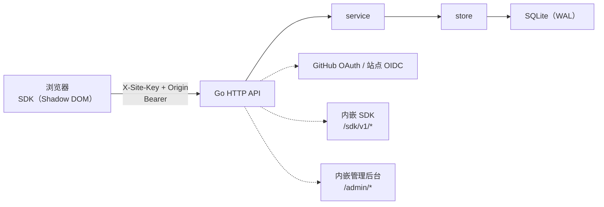

<div align="center">


# 朱批 · zhupi

**多站点、可嵌入的划线批注服务**

选中网页上的文字 → 划线 → 批注与回复。一个实例托管多个站点，任意 Web 前端接入一段脚本即可使用。

[](https://zhupi.pages.dev)
[](go.mod)
[](sdk/package.json)
[](https://github.com/Bin-hy/zhupi/pkgs/container/zhupi)
[](LICENSE)

[官方文档](https://zhupi.pages.dev) · [快速开始](https://zhupi.pages.dev/getting-started/quick-start/) · [SDK 接入](https://zhupi.pages.dev/sdk/integration/) · [GitHub](https://github.com/Bin-hy/zhupi)

</div>

---

## 这是什么

朱批（zhupi）是一个**自托管**的划线批注服务。它把「选中文字 → 划线 → 批注与回复」嵌入到博客、文档站、知识库或任何 Web 页面中。

它和普通评论系统的区别：评论必须挂在某段文字上，而不是文章底部。读者可以精确标注一句话、一个概念或一段代码，讨论始终贴着原文。

> 名字取自「朱批」：古人用朱笔在书页、奏折上圈点批注——红笔划过重点，批语留在页边。和同门的 **yufu（鱼符）** 一样，用一个有身份的古物指代产品本质：鱼符管身份，朱批管批注。

## 特性

| | 能力 |
| --- | --- |
| **多站点隔离** | 一个实例托管多个站点；公开 `siteKey` + Origin 白名单；批注、评论、管理员与审核队列按站点隔离 |
| **可嵌入 SDK** | Shadow DOM UI，不污染宿主样式；支持 `<script>` 与 ESM；SPA 路由切换；暗色主题；中英文 |
| **登录** | 全局 GitHub OAuth + 每站点独立 OIDC + 本地超管兜底；首次登录自动建号，可绑定多身份 |
| **治理** | 超管 / 站点管理员两级权限；先发后审 / 先审后发；批量审核、封禁、隐藏、恢复 |
| **账号中心** | 身份绑定、登录设备管理、退出所有设备；主题与语言切换 |
| **自托管** | 单 Go 二进制 + SQLite（WAL）+ 内嵌 SDK 与管理后台；Docker 一键部署 |
| **开放 API** | 公共批注/评论 API、账号 API、管理 API、健康检查；统一错误结构与请求 ID |
| **许可** | 服务端、SDK、管理后台均为 MIT |

## 架构



- 站点级请求必须带 `X-Site-Key`，且 `Origin` 在该站点白名单内。
- 会话使用 Bearer token；数据库只存 token 的 SHA-256。
- OIDC client secret 使用 AES-256-GCM 加密存储。
- 批注锚点采用 W3C `TextQuoteSelector`，正文变化后做模糊重定位。
- 单二进制 + 单文件数据库，部署只需要一个进程和一个卷。

## 快速开始

### Docker Compose（推荐）

```bash
git clone https://github.com/Bin-hy/zhupi.git
cd zhupi

cp .env.example .env
# 至少修改：
#   PUBLIC_BASE_URL=https://annot.example.com
#   SECRET_KEY=$(openssl rand -hex 32)

docker compose pull
docker compose up -d
```

创建第一个站点：

```bash
docker compose exec zhupi /app/zhupi admin site create \
  --name blog \
  --display-name "我的博客" \
  --origin http://127.0.0.1:5173
```

输出中的 `key` 就是 siteKey。

### 从源码启动

```bash
make build

export SECRET_KEY=$(openssl rand -hex 32)
export DB_PATH=./zhupi.db
export PUBLIC_BASE_URL=http://127.0.0.1:8080
export DEV_LOGIN=1   # 仅本地开发

./bin/zhupi admin site create --name blog --origin http://127.0.0.1:5173
./bin/zhupi serve
```

### 打开示例

```bash
python3 -m http.server 5173
# 打开：
# http://127.0.0.1:5173/examples/plain-html/?siteKey=<key>&api=http://127.0.0.1:8080
```

选中一段文字 → 点击「批注」→ 发布。刷新后划线仍在。

管理后台：<http://127.0.0.1:8080/admin/>，首次启动默认本地超管 `admin` / `admin`，登录后强制改密。

完整步骤与常见问题见 [快速开始](https://zhupi.pages.dev/getting-started/quick-start/)。

## 接入 SDK

```html
<script src="https://annot.example.com/sdk/v1/zhupi.js"></script>
<script>
  ZhupiSDK.init({
    siteKey: 'YOUR_SITE_KEY',
    selectRoot: 'article',   // 允许划词的范围，默认 document.body
    pageKey: location.pathname,
    pageTitle: document.title,
    theme: 'auto',
  })
</script>
```

ESM：

```bash
npm install zhupi-sdk
```

```ts
import { init } from 'zhupi-sdk'

const instance = init({
  siteKey: 'YOUR_SITE_KEY',
  apiBase: 'https://annot.example.com',
  selectRoot: '.article-body',
})
```

SPA 路由切换：

```js
await instance.setPage({ pageKey: location.pathname, pageTitle: document.title })
```

SDK 内置：筛选、游标分页、评论搜索与排序、未读提示、草稿恢复、账号中心、主题与语言、`#annot-<id>` 深链接、orphan 手动重定位。

- [SDK 接入指南](https://zhupi.pages.dev/sdk/integration/)
- [初始化选项](https://zhupi.pages.dev/sdk/options/)
- [方法与事件](https://zhupi.pages.dev/sdk/methods-events/)

## 管理后台

后台内嵌在 `/admin/`，与 API 同源：

- **概览**：站点、用户、内容统计
- **站点**：创建/编辑站点、轮换 siteKey、分配站点管理员
- **审核**：按状态/类型/关键词筛选，服务端搜索，状态计数，URL 同步，批量通过/拒绝/隐藏/恢复
- **评论上下文**：评论会带出所属批注的正文、引用、页面与讨论串
- **封禁**：站点封禁与全局用户封禁
- **OIDC**：站点级提供商配置，保存时做 Discovery 校验

登录方式：全局 GitHub、任意启用站点的 OIDC、本地超管账号密码。

## 登录方式

### GitHub OAuth（全局）

```dotenv
GITHUB_CLIENT_ID=...
GITHUB_CLIENT_SECRET=...
SUPERADMIN_GITHUB_LOGINS=your-github-login
```

回调地址：`${PUBLIC_BASE_URL}/api/v1/auth/github/callback`。

### OIDC（每站点）

在管理后台或 CLI 配置，支持 issuer、client、scopes、允许邮箱域；client secret 加密存储。

回调地址：`${PUBLIC_BASE_URL}/api/v1/auth/oidc/{providerId}/callback`。

### 本地超管

默认 `admin` / `admin`，首次登录强制改密。忘记密码：

```bash
./bin/zhupi admin password reset --username admin
```

详见 [登录与身份](https://zhupi.pages.dev/sites/authentication/)。

## 站点与权限

```bash
# 站点列表
./bin/zhupi admin site list

# 轮换 siteKey（旧 key 立即失效）
./bin/zhupi admin site rotate-key --site <siteKey>

# 分配 / 移除站点管理员
./bin/zhupi admin site add-admin --site <siteKey> --user <GitHub 登录名或用户 ID>
./bin/zhupi admin site remove-admin --site <siteKey> --user <GitHub 登录名或用户 ID>

# 全局用户列表 / 提升超管
./bin/zhupi admin users list
./bin/zhupi admin promote --github-login <login>
```

- **超级管理员**：所有站点、站点设置、全局用户、OIDC、审核。
- **站点管理员**：被分配站点的审核、封禁与 OIDC 提供商，不能修改站点设置。
- **普通用户**：管理自己的批注、评论、身份与会话。

详见 [角色、审核与封禁](https://zhupi.pages.dev/sites/roles-moderation/)。

## API 与 CLI

公共 API（需要 `X-Site-Key` + `Origin`）：

| 方法 | 路径 |
| --- | --- |
| GET | `/api/v1/site-config` |
| GET / POST | `/api/v1/annotations` |
| PATCH / DELETE | `/api/v1/annotations/{id}` |
| POST | `/api/v1/annotations/{id}/comments` |
| DELETE | `/api/v1/comments/{id}` |

账号：`/api/v1/me`、`/api/v1/me/password`、`/api/v1/me/identities`、`/api/v1/me/sessions`。

管理：站点、审核队列、审核动作、封禁、OIDC 提供商。错误统一为：

```json
{ "error": { "code": "site_not_found", "message": "站点不存在", "requestId": "…" } }
```

- [API 概览](https://zhupi.pages.dev/api/overview/)
- [批注与评论 API](https://zhupi.pages.dev/api/annotations/)
- [管理与账号 API](https://zhupi.pages.dev/api/admin-account/)
- [CLI 参考](https://zhupi.pages.dev/cli/reference/)

## 部署

### 镜像

```bash
docker compose pull
docker compose up -d
```

| tag | 说明 | 架构 |
| --- | --- | --- |
| `latest` | 最新 release | amd64 + arm64 |
| `0.2` / `0.2.0` | 具体版本 | amd64 + arm64 |
| `edge` | `main` 最新构建 | amd64 |

GHCR 包已公开，可匿名拉取。用 `ZHUPI_TAG` 切换版本。

### 反向代理

服务只监听宿主机 `127.0.0.1:8080`，由 Caddy/Nginx 提供 HTTPS：

- `deploy/Caddyfile.example`
- `deploy/nginx.conf.example`
- `deploy/zhupi.service`（裸机 systemd）

生产环境设置：

```dotenv
PUBLIC_BASE_URL=https://annot.example.com
TRUST_PROXY=1
```

详见 [Docker 部署](https://zhupi.pages.dev/deployment/docker/) 与 [反向代理与 HTTPS](https://zhupi.pages.dev/deployment/reverse-proxy/)。

### 数据

- SQLite 文件：`/data/zhupi.db`（Docker 命名卷 `zhupi-data`）
- WAL 模式；备份需包含 `-wal` / `-shm`，或使用 `sqlite3 .backup`
- 当前面向单实例；不支持 PostgreSQL / 多实例

详见 [数据与备份](https://zhupi.pages.dev/deployment/backup/) 与 [环境变量](https://zhupi.pages.dev/deployment/configuration/)。

## 官方文档站

文档站位于 [`website/`](website/)，使用 **Astro 7 + Starlight** 构建，部署在 <https://zhupi.pages.dev>。

```bash
cd website
npm install
npm run dev        # http://localhost:4321
npm run build      # 产物 dist/
```

Cloudflare Pages 配置：

| 配置 | 值 |
| --- | --- |
| Root directory | `website` |
| Build command | `npm run build` |
| Output directory | `dist` |
| Node.js | `22.23.4` |

文档覆盖：项目简介、快速开始、核心概念、部署运维、SDK、站点与权限、API、CLI、架构、开发发布、安全与 FAQ。

## 仓库结构

```text
zhupi/
├── cmd/zhupi/          # Go 入口与 CLI（serve / admin）
├── internal/           # config / crypto / domain / store / service / auth / httpapi
├── sdk/                # TypeScript SDK（Shadow DOM），发布为 zhupi-sdk
├── admin/              # Vue 3 + Element Plus 管理后台
├── deploy/             # Caddy / Nginx / systemd 示例
├── examples/           # 纯 HTML 接入示例
├── website/            # Astro 官方文档站（zhupi.pages.dev）
├── Dockerfile          # 多阶段：Node 构建 SDK/后台 → Go embed → Alpine
├── docker-compose.yml
├── Makefile
└── .env.example
```

## 开发与测试

```bash
# 完整构建（SDK + 管理后台 + Go）
make build

# 只构建某一部分
make sdk
make admin
make server

# 测试
go vet ./...
go test ./...
cd sdk && npm run typecheck && npm test
cd admin && npm run typecheck && npm test
```

> `.github/workflows/ci.yml` 目前只跑 SDK 的 typecheck/test/build/verify；Go 与管理后台测试需要本地执行。

推送 `v*` tag 会构建多架构 Docker 镜像并发布 SDK 到 npm；发布前请确认 tag 与 `sdk/package.json` 的版本一致。

- [本地开发与测试](https://zhupi.pages.dev/development/local/)
- [架构与数据模型](https://zhupi.pages.dev/development/architecture/)
- [发布流程](https://zhupi.pages.dev/development/release/)

## 安全

- `siteKey` 是公开标识，访问控制靠 Origin 白名单；生产不要开启 `ALLOW_MISSING_ORIGIN`。
- `DEV_LOGIN` 仅本地开发；生产严禁开启。
- 会话 token 在服务端只存 SHA-256；SDK 存在 `localStorage`，宿主页面需做好 XSS 防护。
- OIDC client secret 使用 `SECRET_KEY` 加密；更换密钥会导致已保存的 secret 无法解密。
- 备份数据库时必须同时备份 `SECRET_KEY`。
- 批注/评论渲染先转义 HTML，再放行白名单 Markdown 语法。

详见 [安全边界](https://zhupi.pages.dev/reference/security/)。

## V1 边界

- 不提供 SaaS 托管、计费与租户运营。
- 无邮箱密码注册、找回密码、邮件通知、Webhook。
- 无敏感词、举报、自动反垃圾。
- 不支持 PostgreSQL / 多实例。
- 不兼容旧单站点 API，不迁移旧数据。
- SDK 登录为整页跳转，弹窗 + `postMessage` 留到后续版本。

详见 [V1 边界与路线](https://zhupi.pages.dev/reference/boundaries/)。

## 许可

[MIT License](LICENSE) © 2026 Bin-hy

SDK 同时发布在 npm：[`zhupi-sdk`](https://www.npmjs.com/package/zhupi-sdk)。
